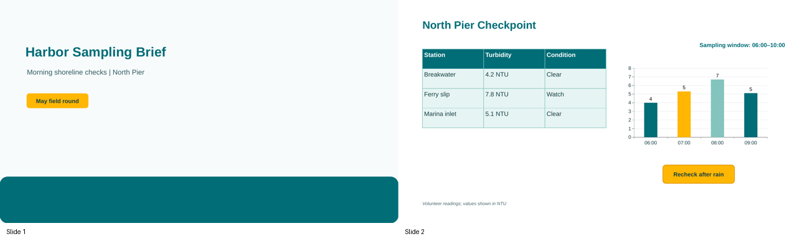
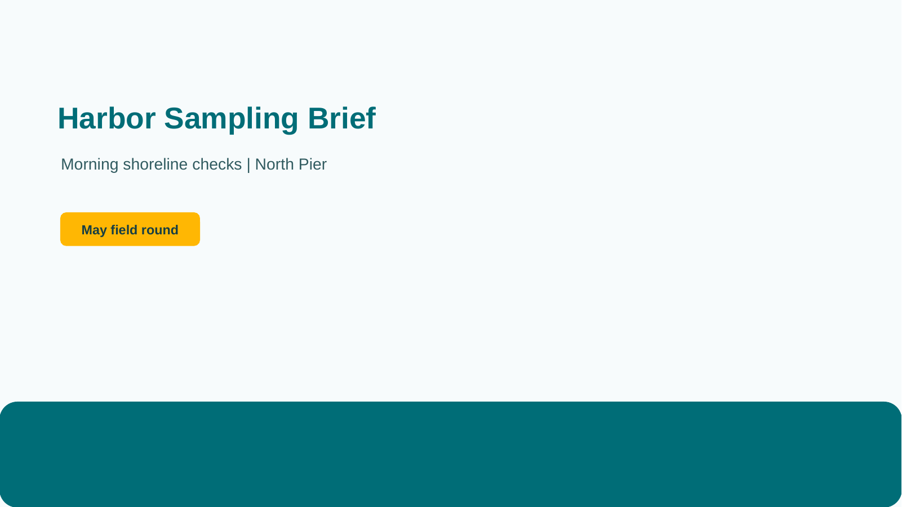
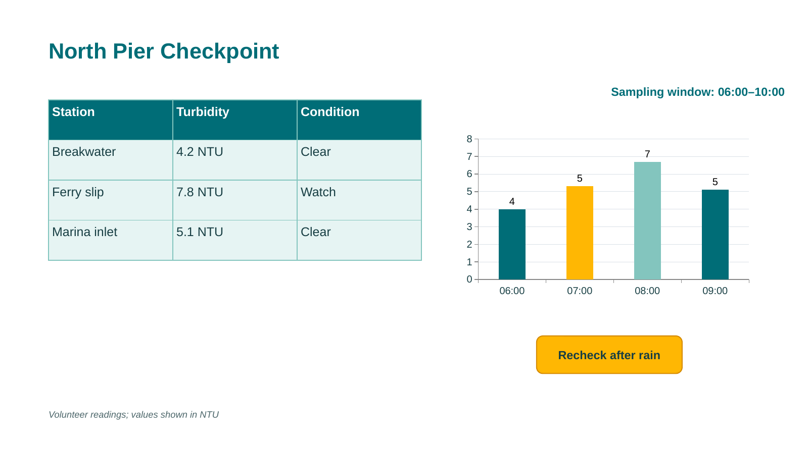

# Harbor Sampling Brief

- Reference task: `reference-task-impress-full-v2-r01-001`
- Application: `libreoffice_impress`
- Review decision: `pending`

## Task instruction

Refresh the “Harbor Sampling Brief” status slide as a field-ready monitoring card: set its slide background to the predefined Light Blue color, move the “Sampling window: 06:00–10:00” status label from the upper-right area to the lower-left area beneath the reading table, and make every character in that label underlined at 18 pt. Keep the table, trend graphic, and advisory badge in their current positions.

## Required skills

### 1. Reposition a text box by dragging

Skill ID: `15aece23-a215-4579-91b4-69eec72e18da.skill-01`

Procedure:

1. In the Slides pane, select the slide containing the text box.
2. Click the text box once to select its outer border rather than entering text-editing mode.
3. Drag the selected text box to the desired location on the slide; for example, drag a title text box downward toward the bottom edge.

Efficiency tip: Use a single click on the object border before dragging, then drag directly to the destination; avoid entering text-editing mode, which can select characters instead of moving the object.

Source task: `15aece23-a215-4579-91b4-69eec72e18da`

Source instruction: Move the title of page 2 to the bottom of the slide.

Directly referenced source actions:

- Action 0: <code>`CLICK` slide 2</code>
- Action 1: <code>`CLICK` Product Comparison text box</code>
- Action 2: <code>`DRAG_TO` bottom of the slide</code>

### 2. Underline all text in a selected text box

Skill ID: `4ed5abd0-8b5d-47bd-839f-cacfa15ca37a.skill-02`

Procedure:

1. After the text in a text box is selected in text-editing mode, click the Underline toolbar icon.
2. For example, select an entire title with Ctrl+A and click Underline once to apply underlining to every selected character.
3. Repeat for each additional text box that needs the same character formatting.

Efficiency tip: Apply underline while the text remains selected after other character formatting, so no extra text selection is required.

Source task: `4ed5abd0-8b5d-47bd-839f-cacfa15ca37a`

Source instruction: Set the color of titles in slides 2,3,5 as black and underline them.

Directly referenced source actions:

- Action 5: <code>`CLICK` underline icon</code>
- Action 11: <code>`CLICK` underline icon</code>
- Action 17: <code>`CLICK` underline icon</code>

### 3. Set the font size of text in a text box

Skill ID: `a434992a-89df-4577-925c-0c58b747f0f4.skill-02`

Procedure:

1. Click the text box containing the text to format.
2. Select the existing value in the font-size field, for example by triple-clicking it.
3. Type the desired point size, such as 12, and press Enter to apply it.

Efficiency tip: Replace the existing size value directly in the toolbar field instead of incrementing or decrementing the size repeatedly.

Source task: `a434992a-89df-4577-925c-0c58b747f0f4`

Source instruction: Change the font size of the content to 12, and change the font color to orange. Change the slide's background to red.

Directly referenced source actions:

- Action 4: <code>`CLICK` the content text box</code>
- Action 5: <code>`TRIPLE_CLICK` the font size text field</code>
- Action 6: <code>`TYPING` 12</code>
- Action 7: <code>`PRESS` enter</code>

### 4. Set a slide background to a predefined color

Skill ID: `70bca0cc-c117-427e-b0be-4df7299ebeb6.skill-02`

Procedure:

1. Select the target slide thumbnail so that formatting applies to the slide rather than an object on the canvas.
2. Open the slide Background menu, choose the background color option, and open its color palette.
3. Click the desired palette swatch. For example, choose a red swatch to make the entire slide background red.

Efficiency tip: Select the slide in the Slides pane before opening Background settings to avoid changing the fill color of a currently selected text box or shape.

Source task: `70bca0cc-c117-427e-b0be-4df7299ebeb6`

Source instruction: Make the background color of slide 2 same as the color of its title.

Directly referenced source actions:

- Action 3: <code>`CLICK` slide 2.</code>
- Action 4: <code>`CLICK` slide 2.</code>
- Action 5: <code>`CLICK` background menu.</code>
- Action 6: <code>`CLICK` color</code>
- Action 7: <code>`CLICK` color menu</code>
- Action 8: <code>`CLICK` red (2nd row, 5th from right)</code>

## Initial artifact

- Domain: Community harbor water-quality monitoring
- Presentation: [initial_artifact.pptx](artifact/initial_artifact.pptx)
- Blueprint: [artifact_blueprint.json](artifact/artifact_blueprint.json)
- QA report: [artifact_qa.json](artifact/artifact_qa.json)

Initial state:

- The deck opens with slide 2 selected in Normal view.
- Slide 2 has a white background, not the requested predefined Light Blue background.
- The sampling_window_label is an editable text box positioned in the upper-right area of slide 2, above and separate from the readings table.
- The sampling_window_label text is 14 pt and has no underline formatting.
- The station_readings_table, turbidity_trend_chart, advisory_badge, and source_caption are already present and should remain where they are.
- All planned text, shapes, table cells, and chart elements are editable static presentation objects.

Artifact construction requirements:

- Build a wide, two-slide PPTX using only editable static text, shape, table, and chart objects.
- On slide 2, place sampling_window_label clearly in the upper-right quadrant and leave open lower-left space immediately beneath station_readings_table for its requested destination.
- Use a white slide 2 background initially so the Light Blue background change is readily reviewable.
- Set sampling_window_label initially to 14 pt in the body font with underline disabled.
- Do not use native placeholders, speaker notes, transitions, animations, embedded media, or external assets.

| Slide | Layout | Purpose | Editable objects |
| ---: | --- | --- | --- |
| 1 | title | Cover for a concise community monitoring briefing | cover_title (text), cover_subtitle (text), cover_water_band (shape), cover_date_tag (shape) |
| 2 | data_story | Field-ready summary of the current sampling window and station readings | status_slide_heading (text), sampling_window_label (text), station_readings_table (table), turbidity_trend_chart (chart), advisory_badge (shape), source_caption (text) |

Must remain incomplete before recording:

- Do not set slide 2 to the requested Light Blue background in the initial deck.
- Do not place sampling_window_label in the requested lower-left position in the initial deck.
- Do not underline sampling_window_label in the initial deck.
- Do not set sampling_window_label to 18 pt in the initial deck.

Artifact previews:

### contact-sheet



### slide-01



### slide-02



## Operator guide

### Demonstration 1

- Skill: `15aece23-a215-4579-91b4-69eec72e18da.skill-01`
- Intent: Relocate the sampling-window status text box from the upper-right portion of slide 2 to the designated open lower-left area beneath the table.
- Efficiency: Select the text box border once, then drag the object rather than entering text-editing mode.
- Visible success: The entire “Sampling window: 06:00–10:00” text box appears below the table on the lower-left, while the table and chart have not moved.

### Demonstration 2

- Skill: `4ed5abd0-8b5d-47bd-839f-cacfa15ca37a.skill-02`
- Intent: Apply underline formatting to every character in the sampling-window status label.
- Efficiency: Select all text in the label before applying Underline so the whole label is formatted in one action.
- Visible success: Both the “Sampling window:” text and the “06:00–10:00” time range have a continuous underline.

### Demonstration 3

- Skill: `a434992a-89df-4577-925c-0c58b747f0f4.skill-02`
- Intent: Change the sampling-window status label to 18 pt.
- Efficiency: Replace the font-size value directly in the toolbar field rather than stepping through size increments.
- Visible success: The status label is visibly larger than its initial 14 pt appearance and displays as 18 pt when its text is selected.

### Demonstration 4

- Skill: `70bca0cc-c117-427e-b0be-4df7299ebeb6.skill-02`
- Intent: Apply the predefined Light Blue color to slide 2’s background.
- Efficiency: Select the slide thumbnail before opening Background settings so the color applies to the slide rather than a selected object.
- Visible success: The full slide canvas behind all slide 2 objects is Light Blue, with the objects retaining their own fills and positions.

Recording start: Open the supplied two-slide presentation with slide 2 selected; all requested changes are intentionally incomplete.

Recording end: Slide 2 has a predefined Light Blue background, and its sampling-window label is positioned beneath the table at lower-left, fully underlined, and 18 pt.

Allowed variation: The exact drag path and the sequence used for text formatting may vary, provided the specified final placement, 18 pt size, full underline, and predefined Light Blue slide background are visible.

## Expected incidental operations

- **scaffolding:** Select slide 2 in the Slides pane before changing its background. Reason: Ensures the background command targets the slide rather than an object.
- **substantive_prerequisite:** Select the sampling-window text box and enter text-editing mode to select its complete text. Reason: Required to apply the requested character-level underline and font-size formatting to the full label.
- **scaffolding:** Deselect the text insertion point and select the sampling-window text box border before dragging. Reason: Required to move the complete text box without altering its text content.

## Source-similarity audit

| Measure | Maximum | Most similar source task |
| --- | ---: | --- |
| Lexical sequence similarity | 0.290598 | 05dd4c1d-c489-4c85-8389-a7836c4f0567 |
| Semantic cosine similarity | 0.523926 | 04578141-1d42-4146-b9cf-6fab4ce5fd74 |

Scores are reviewer aids, not automatic acceptance thresholds. Compare the task with the source instructions and actions above for solution leakage.

## Review this package

Check that every required skill is necessary and observable, the task is natural and not a source-solution reproduction, incidental operations are limited, the artifact matches its specification, and the guide remains helpful without prescribing one click-by-click trajectory.

1. Inspect the task, required skills, source evidence, artifact, and guide.
2. Fill [review.json](review.json) using `approved`, `revision_requested`, or `rejected`.
3. From the repository root, collect all completed forms:

```bash
python scripts/python/manage_reference_review_packets.py collect
```

Detailed field guidance is in [`reviewer.md`](../../../reviewer.md).

## Start annotation after approval

```bash
python scripts/python/record_reference_task.py \
  --reference-task-id reference-task-impress-full-v2-r01-001
```

The ordinary launcher reads the collected central review file and refuses pending, revision-requested, or rejected tasks.
