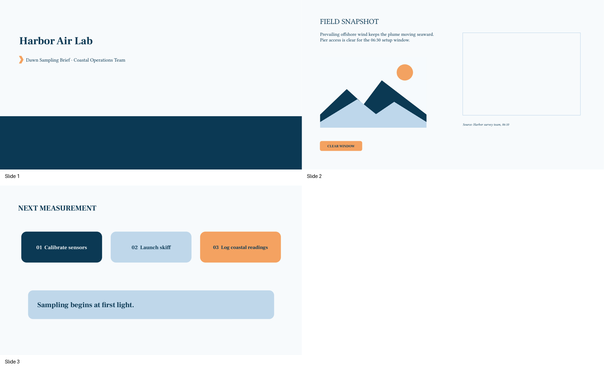
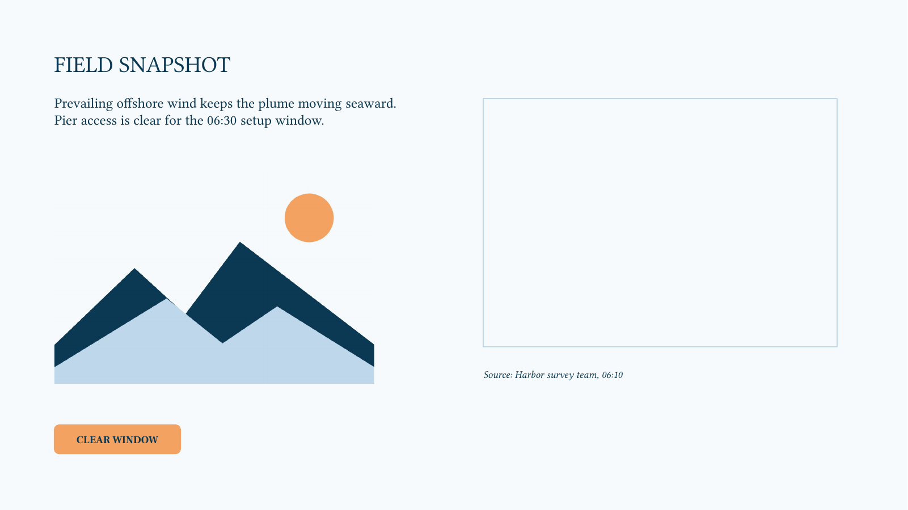
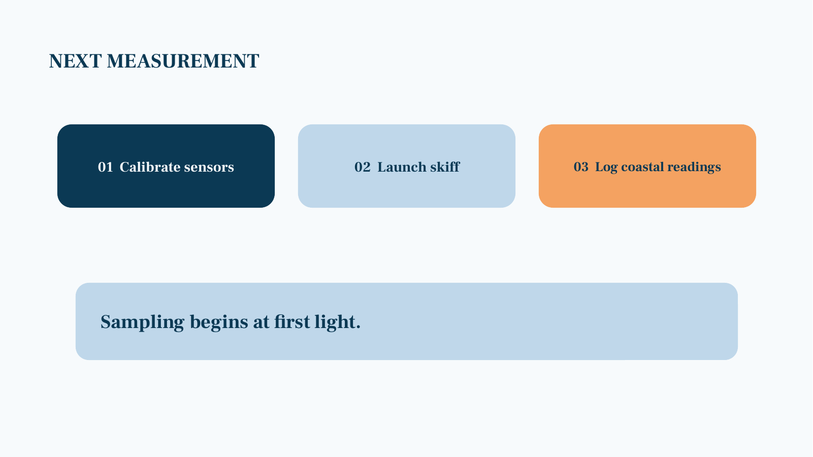

# Harbor Air Lab: Dawn Sampling Brief

- Reference task: `reference-task-impress-full-v2-r01-002`
- Application: `libreoffice_impress`
- Review decision: `pending`

## Task instruction

Finalize the Harbor Air Lab briefing: on the “Field Snapshot” slide, move the coastal landscape illustration from the left panel into the right-side image frame, make the heading “FIELD SNAPSHOT” bold, and right-align the source line beneath the image. On the following “Next Measurement” slide, center the text in the closing callout, “Sampling begins at first light.” Keep all wording and other slide elements unchanged.

## Required skills

### 1. Apply bold formatting to text in a slide text box

Skill ID: `7dbc52a6-11e0-4c9a-a2cb-1e36cfda80d8.skill-01`

Procedure:

1. Select the text box whose text should be formatted, entering text-editing mode if necessary so the formatting applies to its characters rather than the object border.
2. Use Ctrl+B to toggle bold formatting for the selected text or for subsequently entered text. For example, click inside a slide title and press Ctrl+B to make the title bold.

Efficiency tip: Use Ctrl+B rather than opening the formatting toolbar; verify that the text caret or selected text is active so you do not merely select the text box object.

Source task: `7dbc52a6-11e0-4c9a-a2cb-1e36cfda80d8`

Source instruction: On page 2, add a note same to the title into the slide. Make the font of title bold.

Directly referenced source actions:

- Action 1: <code>`CLICK` &#x27;Team Members&#x27; box in the slide.</code>
- Action 2: <code>`HOTKEY` Ctrl-B</code>

### 2. Move a selected image by dragging

Skill ID: `2b94c692-6abb-48ae-ab0b-b3e8a19cb340.skill-01`

Procedure:

1. Select the slide containing the image in the Slides pane, for example Slide 2.
2. Move the pointer over the image and drag it to the desired position on the slide canvas, such as toward the right side.
3. Release the mouse button when the image is positioned correctly.

Efficiency tip: Drag the image by its interior rather than a resize handle, and use alignment guides if they appear to place it accurately in one movement.

Source task: `2b94c692-6abb-48ae-ab0b-b3e8a19cb340`

Source instruction: Move the image to the right side on Slide 2.

Directly referenced source actions:

- Action 0: <code>`CLICK` Slide 2.</code>
- Action 1: <code>`MOVE_TO` the image</code>
- Action 2: <code>`DRAG_TO` the right side of the slide</code>

### 3. Align paragraph text to the right in a text box

Skill ID: `08aced46-45a2-48d7-993b-ed3fb5b32302.skill-01`

Procedure:

1. Enter text-editing mode in the target text box, for example by clicking inside its title text.
2. Click the Right Align toolbar icon to align the current paragraph to the right edge of the text box.

Efficiency tip: Place the text cursor in the intended paragraph before using Right Align; this avoids changing alignment on a different object or paragraph.

Source task: `08aced46-45a2-48d7-993b-ed3fb5b32302`

Source instruction: Give the slide 2 the right aligned title, "Note".

Directly referenced source actions:

- Action 1: <code>`CLICK` the title text box</code>
- Action 3: <code>`CLICK` right align icon.</code>

### 4. Align paragraph text within a selected text box

Skill ID: `05dd4c1d-c489-4c85-8389-a7836c4f0567.skill-01`

Procedure:

1. In the Slides pane, select the slide containing the text box to format.
2. Click inside the text box to enter text-editing mode, then use Ctrl+A to select its text.
3. Click the desired paragraph-alignment control in the toolbar, such as Right Align, Center Align, or Left Align.
4. For example, select the text in a text box and click Center Align to center all selected paragraphs within that box.

Efficiency tip: Select the text directly with Ctrl+A after entering the text box, then apply one alignment command; this avoids changing alignment on the wrong object or only affecting an insertion point.

Source task: `05dd4c1d-c489-4c85-8389-a7836c4f0567`

Source instruction: Align the first textbox on slide 3 to the right, on slide 4 to the center, and on slide 5 to the left. Ensure that the alignment is applied correctly to each respective slide.

Directly referenced source actions:

- Action 0: <code>`CLICK` Slide 3</code>
- Action 1: <code>`CLICK` &#x27;HELLO&#x27;</code>
- Action 2: <code>`HOTKEY` ctrl-A</code>
- Action 3: <code>`CLICK` right-align icon</code>
- Action 4: <code>`CLICK` Slide 4</code>
- Action 5: <code>`CLICK` &#x27;WRITE&#x27;</code>
- Action 6: <code>`HOTKEY` ctrl-A</code>
- Action 7: <code>`CLICK` center-align icon</code>
- Action 8: <code>`CLICK` Slide 5</code>
- Action 9: <code>`CLICK` &#x27;WRITE&#x27;</code>
- Action 10: <code>`HOTKEY` ctrl-A</code>
- Action 11: <code>`CLICK` left-align icon under paragraph section</code>

## Initial artifact

- Domain: Environmental field briefing for a harbor air-quality sampling team
- Presentation: [initial_artifact.pptx](artifact/initial_artifact.pptx)
- Blueprint: [artifact_blueprint.json](artifact/artifact_blueprint.json)
- QA report: [artifact_qa.json](artifact/artifact_qa.json)

Initial state:

- The deck contains three editable wide-format slides using the Harbor Air Lab theme.
- On slide 2, the coastal landscape illustration is visibly in the left panel while an empty outlined destination frame is visibly present on the right panel.
- On slide 2, “FIELD SNAPSHOT” is regular weight, not bold.
- On slide 2, the source line below the right-side frame is left-aligned.
- On slide 3, the closing callout text is left-aligned within its wide callout area.

Artifact construction requirements:

- Use a privacy-safe, builder-generated shoreline illustration rather than an external photograph or a copied source asset.
- Create all displayed text as editable text objects, not native placeholder controls.
- Place the image frame and source line so the requested move and right alignment yield an unambiguous visual result.
- Use object geometry that leaves sufficient room for the image to move from the left panel to the right panel without overlapping the heading or source line.

| Slide | Layout | Purpose | Editable objects |
| ---: | --- | --- | --- |
| 1 | title | Briefing cover that establishes the harbor sampling theme. | cover_horizon_band (shape), cover_title (text), cover_subtitle (text), cover_wave_mark (shape) |
| 2 | two_column | Field snapshot with an image placement target and a concise source citation. | snapshot_heading (text), snapshot_context (text), snapshot_image_frame (shape), snapshot_coastal_landscape (image), snapshot_source_line (text), snapshot_status_chip (shape) |
| 3 | process | Next-step slide that closes the briefing with a centered operational callout. | measurement_heading (text), measurement_step_one (shape), measurement_step_two (shape), measurement_step_three (shape), measurement_closing_callout (text), measurement_callout_backing (shape) |

Must remain incomplete before recording:

- Do not move the coastal landscape illustration into the right-side image frame.
- Do not bold the “FIELD SNAPSHOT” heading.
- Do not right-align the slide 2 source line.
- Do not center the slide 3 closing callout text.
- Do not alter the slide order, theme colors, wording, or other objects.

Artifact previews:

### contact-sheet



### slide-01


### slide-02



### slide-03



## Operator guide

### Demonstration 1

- Skill: `7dbc52a6-11e0-4c9a-a2cb-1e36cfda80d8.skill-01`
- Intent: Apply bold character formatting to the slide 2 heading only.
- Efficiency: Enter text-editing mode in the heading and use Ctrl+B with the heading text selected or the insertion point in that text.
- Visible success: “FIELD SNAPSHOT” has a visibly heavier weight while its wording, position, and color remain unchanged.

### Demonstration 2

- Skill: `2b94c692-6abb-48ae-ab0b-b3e8a19cb340.skill-01`
- Intent: Relocate the slide 2 coastal landscape illustration into the outlined destination frame on the right.
- Efficiency: Drag from the image interior rather than a sizing handle; use the visible frame edges as the placement reference.
- Visible success: The coastal landscape illustration occupies the right-side frame area, and the left panel no longer contains the illustration.

### Demonstration 3

- Skill: `08aced46-45a2-48d7-993b-ed3fb5b32302.skill-01`
- Intent: Right-align the slide 2 source citation paragraph.
- Efficiency: Place the text cursor in the source paragraph before applying Right Align.
- Visible success: The citation’s right edge aligns with the right edge of its text box beneath the image frame.

### Demonstration 4

- Skill: `05dd4c1d-c489-4c85-8389-a7836c4f0567.skill-01`
- Intent: Center the paragraph in the slide 3 closing callout.
- Efficiency: Enter the callout text box, select its text, and apply Center Align once.
- Visible success: “Sampling begins at first light.” is centered horizontally in the pale-blue callout area.

Recording start: Open the supplied three-slide presentation in normal slide editing view with all specified incomplete states visible.

Recording end: Slide 2 has the image in the right frame, a bold heading, and a right-aligned source line; slide 3 has a centered closing callout.

Allowed variation: Minor differences in the precise image drop point are acceptable if the image is clearly positioned within the right-side outlined frame. The requested text formatting and paragraph alignments must remain exact.

## Expected incidental operations

- **scaffolding:** Navigate between slides 2 and 3 in the Slides pane. Reason: The coordinated edits are located on two related content slides.
- **substantive_prerequisite:** Enter text-editing mode and select text in the heading, source line, and closing callout as needed. Reason: Character formatting and paragraph alignment must apply to text rather than to the containing objects.
- **substantive_prerequisite:** Select the coastal landscape illustration before dragging it. Reason: The image must be selected to relocate it into the designated frame.

## Source-similarity audit

| Measure | Maximum | Most similar source task |
| --- | ---: | --- |
| Lexical sequence similarity | 0.274583 | a434992a-89df-4577-925c-0c58b747f0f4 |
| Semantic cosine similarity | 0.525306 | 08aced46-45a2-48d7-993b-ed3fb5b32302 |

Scores are reviewer aids, not automatic acceptance thresholds. Compare the task with the source instructions and actions above for solution leakage.

## Review this package

Check that every required skill is necessary and observable, the task is natural and not a source-solution reproduction, incidental operations are limited, the artifact matches its specification, and the guide remains helpful without prescribing one click-by-click trajectory.

1. Inspect the task, required skills, source evidence, artifact, and guide.
2. Fill [review.json](review.json) using `approved`, `revision_requested`, or `rejected`.
3. From the repository root, collect all completed forms:

```bash
python scripts/python/manage_reference_review_packets.py collect
```

Detailed field guidance is in [`reviewer.md`](../../../reviewer.md).

## Start annotation after approval

```bash
python scripts/python/record_reference_task.py \
  --reference-task-id reference-task-impress-full-v2-r01-002
```

The ordinary launcher reads the collected central review file and refuses pending, revision-requested, or rejected tasks.
