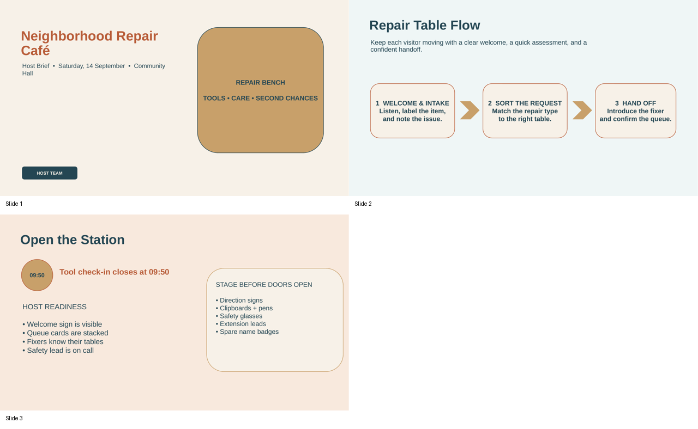
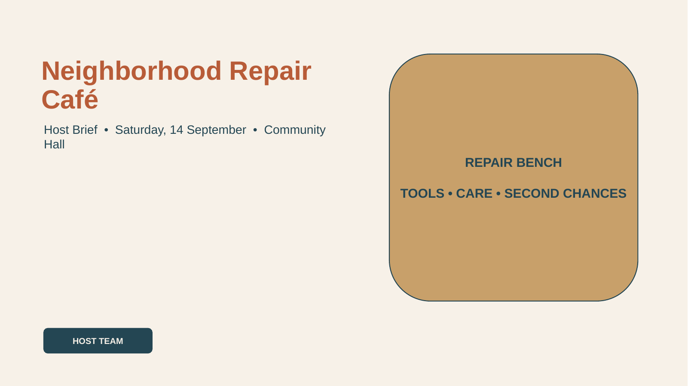
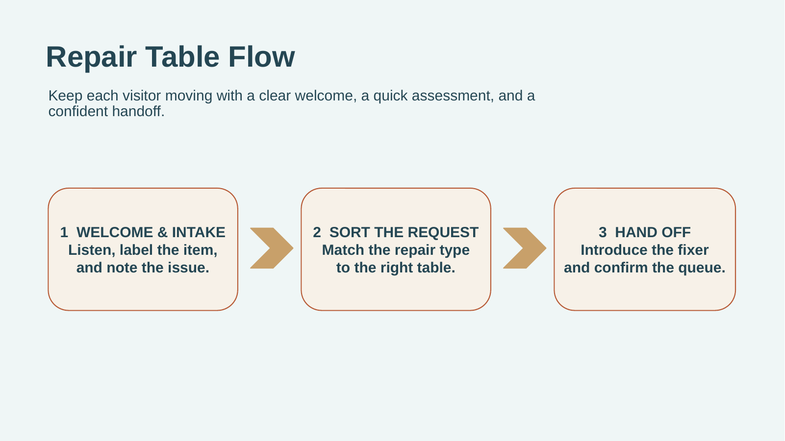
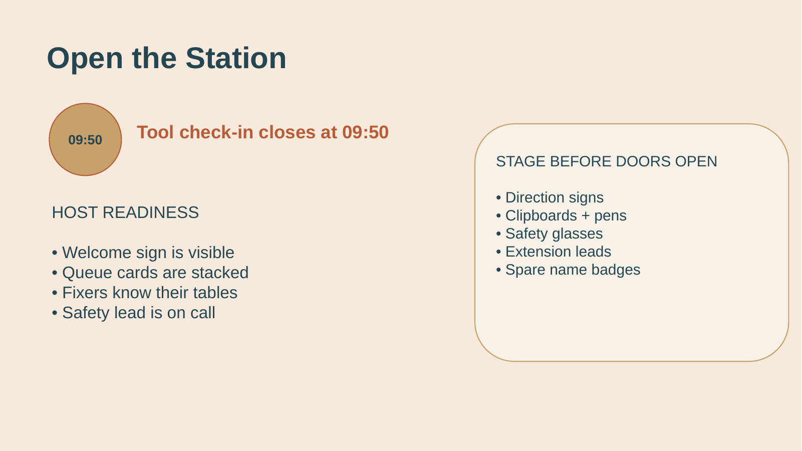

# Neighborhood Repair Café — Host Brief

- Reference task: `reference-task-impress-full-v2-r01-003`
- Application: `libreoffice_impress`
- Review decision: `pending`

## Task instruction

Update the “Neighborhood Repair Café” host brief for the workshop team. First inspect the copper color used by the cover headline and use that verified color for the titles on both activity slides. Select the two activity slides together and give them the shared pale-sage background. On the “Repair Table Flow” slide, set the title to 44 pt using the font-size list, and set the “Tool check-in closes at 09:50” schedule line to an exact 27 pt so it remains a distinct operational cue.

## Required skills

### 1. Multi-select slide thumbnails in the Slides pane

Skill ID: `9ec204e4-f0a3-42f8-8458-b772a6797cab.skill-01`

Procedure:

1. In the Slides pane, click the first slide thumbnail to select it.
2. Hold Ctrl and click another thumbnail to add it to the selection without deselecting the first. For example, select two adjacent ending slides before applying a shared command.
3. Release Ctrl after all intended thumbnails are selected.

Efficiency tip: Use Ctrl-click to build a noncontiguous or multi-slide selection in one pass instead of applying the same command separately to each slide.

Source task: `9ec204e4-f0a3-42f8-8458-b772a6797cab`

Source instruction: Please duplicate the last two slides and insert the copies in alternating order, so the sequence becomes: original slide A, original slide B, then duplicated slide A, duplicated slide B.

Directly referenced source actions:

- Action 1: <code>`CLICK` slide 23</code>
- Action 2: <code>`KEY_DOWN` Ctrl</code>
- Action 3: <code>`CLICK` slide 24</code>
- Action 4: <code>`KEY_UP` Ctrl</code>

### 2. Inspect a text object's current font color

Skill ID: `70bca0cc-c117-427e-b0be-4df7299ebeb6.skill-01`

Procedure:

1. Select the slide containing the text object.
2. Click the text box once to select it, then open the Font Color drop-down on the toolbar.
3. Use the color currently indicated for the selected text as the reference color. For example, inspect a slide title before applying the same color elsewhere.

Efficiency tip: Open the color control only after selecting the text object; otherwise the displayed color may reflect a default or a different selection.

Source task: `70bca0cc-c117-427e-b0be-4df7299ebeb6`

Source instruction: Make the background color of slide 2 same as the color of its title.

Directly referenced source actions:

- Action 0: <code>`CLICK` slide 2</code>
- Action 1: <code>`CLICK &#x27;Our customers love us&#x27; text box</code>
- Action 2: <code>`CLICK` font color dropdown</code>

### 3. Set an exact font size for text in a text box

Skill ID: `3161d64e-3120-47b4-aaad-6a764a92493b.skill-01`

Procedure:

1. Select the slide containing the text box from the Slides pane.
2. Enter text-editing mode in the target text box and select the text whose size should change; for example, triple-click within the text to select its paragraph or text content.
3. Click the font-size field on the formatting toolbar, replace its current value with an exact point size such as 60 pt, and press Enter to apply it.
4. Repeat the same process for any other text object needing a different size, such as entering 28 pt for a second text box.

Efficiency tip: Type the desired point value directly into the font-size field instead of searching the dropdown list; this is faster and supports sizes not shown among preset options.

Source task: `3161d64e-3120-47b4-aaad-6a764a92493b`

Source instruction: Make the first textbox font size 60 pt while the second 28 pt on slide 14.

Directly referenced source actions:

- Action 0: <code>`SCROLL` down to slide 14.</code>
- Action 1: <code>`CLICK` slide 14.</code>
- Action 2: <code>`TRIPLE_CLICK` target audience</code>
- Action 3: <code>`TRIPLE_CLICK` font size text field</code>
- Action 4: <code>`TYPING` 60 pt</code>
- Action 5: <code>`PRESS` enter</code>
- Action 6: <code>`TRIPLE_CLICK` &#x27;Elaborate...&#x27;</code>
- Action 7: <code>`TRIPLE_CLICK` font size dropdown</code>
- Action 8: <code>`TYPING` 28 pt</code>
- Action 9: <code>`PRESS` enter</code>

### 4. Set the font size of selected text

Skill ID: `5c1a6c3d-c1b3-47cb-9b01-8d1b7544ffa1.skill-03`

Procedure:

1. Keep the target text selected in its text object.
2. Open the font-size dropdown on the formatting toolbar.
3. Choose the required point size; for example, select 44 pt to make selected title text 44 points.

Efficiency tip: Set the size on an existing text selection before clicking elsewhere, which preserves the target range and avoids re-entering text-editing mode.

Source task: `5c1a6c3d-c1b3-47cb-9b01-8d1b7544ffa1`

Source instruction: Bold the text on slide 1. Make the title of size 44pt and underline it on slide 1.

Directly referenced source actions:

- Action 4: <code>`CLICK` font size dropdown</code>
- Action 5: <code>`CLICK` 44 pt</code>

## Initial state preview

### contact-sheet



### slide-01



### slide-02



### slide-03



## Operator guide

### Existing operation-intent guide

#### Demonstration 1

- Skill: `9ec204e4-f0a3-42f8-8458-b772a6797cab.skill-01`
- Intent: Build a two-slide selection for the related activity slides before applying their shared background treatment.
- Efficiency: Click Slide 2, then Ctrl-click Slide 3 so the common background can be applied as one grouped slide operation.
- Visible success: Slides 2 and 3 are simultaneously highlighted in the Slides pane, and both subsequently show the same pale-sage background.

#### Demonstration 2

- Skill: `70bca0cc-c117-427e-b0be-4df7299ebeb6.skill-01`
- Intent: Verify the approved copper title color from the cover headline before using it on the activity-slide titles.
- Efficiency: Select the cover headline itself before opening the font-color control, rather than relying on a toolbar default.
- Visible success: With the cover headline selected, the font-color control indicates the copper reference color; both activity titles later visibly match that hue.

#### Demonstration 3

- Skill: `3161d64e-3120-47b4-aaad-6a764a92493b.skill-01`
- Intent: Set the Slide 3 operational schedule line to its non-preset exact size of 27 pt.
- Efficiency: Enter text-editing mode, select the complete schedule line, type 27 in the font-size field, and confirm it.
- Visible success: The full “Tool check-in closes at 09:50” line is visibly larger than its initial state and reports 27 pt when its text is selected.

#### Demonstration 4

- Skill: `5c1a6c3d-c1b3-47cb-9b01-8d1b7544ffa1.skill-03`
- Intent: Use the font-size dropdown to promote the Slide 2 workflow title to 44 pt.
- Efficiency: Keep the title text selected while choosing 44 pt from the size list so the formatting applies only to that title.
- Visible success: The selected “Repair Table Flow” title is visibly more prominent and reports 44 pt.

Recording start: Open the generated presentation in normal editing view with all three slide thumbnails visible and no text object selected.

Recording end: Slides 2 and 3 share pale-sage backgrounds and copper titles; the Slide 2 title is 44 pt and the Slide 3 schedule line is 27 pt.

Allowed variation: Minor selection and toolbar-navigation paths may vary, provided the specified objects, colors, font sizes, shared backgrounds, and slide order are preserved.

### 中文详细参考方案

> 以下是一个可以参考的操作 guide。标注者可以根据实际 LibreOffice 界面采用等价操作。

本指南将封面标题的已批准铜色作为可验证的格式来源，随后统一处理两张活动幻灯片的背景与标题，并分别调整两处指定文字的字号。所有文字和图形均应保留为可编辑对象；不改动幻灯片顺序、正文措辞或封面内容。

#### 启动后的初始状态检查

- 确认处于普通编辑视图，左侧 `Slides` 窗格中能同时看到 3 张缩略图，且当前没有文本插入光标或对象边框处于选中状态。
- 确认 Slide 1 标题为 “Neighborhood Repair Café”；Slide 2 标题为 “Repair Table Flow”；Slide 3 包含 “Tool check-in closes at 09:50”。这些是本任务仅需格式化的文字目标。
- 确认初始时 Slide 2 与 Slide 3 的背景可见地不同、两张活动页标题为深色、Slide 2 标题尚未达到 44 pt、Slide 3 的日程行尚未达到 27 pt。若文件已经部分符合最终外观，只对仍不匹配的项目执行相应修复，勿重写任何文字。
- 确认 Slide 1 的暖亚麻背景、封面副标题、插图和页脚标签均存在；Slide 2 的三步流程图、Slide 3 的清单与 supplies panel 均应保留。

#### 第 1 步：检查并记录封面标题的铜色

1. 在 `Slides` 窗格单击 Slide 1 缩略图；这是选择幻灯片，不是选择其中文字。
2. 在画布上对 “Neighborhood Repair Café” 文本框单击一次，使整个文本对象出现对象边框和控制点；此时不要双击进入文字编辑模式。
3. 在格式工具栏打开 `Font Color` 的下拉箭头，读取当前针对所选标题显示的颜色。可接受的正确参考色为铜色 `#B85C38`；仅检查到该色时无需改动封面标题。
4. 如果颜色控制显示的不是 `#B85C38`，先检查是否误选了幻灯片或其他对象：按 `Esc` 后重新单击标题文本框的边框，再打开 `Font Color`。不要将任何颜色应用到 Slide 1。

- 对应 skills：`70bca0cc-c117-427e-b0be-4df7299ebeb6.skill-01`
- 高效操作：一定要在标题文本对象已出现边框后再打开 `Font Color`；否则工具栏显示的可能是默认色，而不是封面标题的实际颜色。
- 完成标志：“Neighborhood Repair Café” 的文本框被选中，`Font Color` 所示参考色为 `#B85C38`，封面文字和背景外观没有变化。

#### 第 2 步：同时选择两张活动幻灯片并应用共享背景

1. 在左侧 `Slides` 窗格单击 Slide 2 缩略图，然后按住 `Ctrl` 再单击 Slide 3 缩略图，最后松开 `Ctrl`。这是缩略图多选；不要在画布中按住 `Ctrl` 去选择文字或形状。
2. 两张缩略图同时高亮时，使用 `Format` > `Slide Properties...`，在对话框中打开 `Background`。将填充设为纯色，并在颜色控件选择或自定义淡鼠尾草色 `#E3EAD7`，再确认应用。
3. 如果对话框中已有与 `#E3EAD7` 相同的纯色背景，保持该设置即可，无需重复应用。若 Slide 2 或 Slide 3 仍显示原来的蓝灰或浅桃色，重新按 `Ctrl` 同时选择这两张缩略图后再应用 `#E3EAD7`；不要选择 Slide 1。
4. 应用后单击画布空白处或任一单独缩略图以结束多选，避免后续标题编辑误作用于多张幻灯片。

- 对应 skills：`9ec204e4-f0a3-42f8-8458-b772a6797cab.skill-01`
- 高效操作：先完成 `Ctrl` 多选再执行一次背景命令，可让两页获得完全相同的背景，避免逐页设置造成色差。
- 完成标志：Slide 2 和 Slide 3 缩略图均呈选中状态时已一次性应用背景；之后两页画布和缩略图都显示相同的淡鼠尾草 `#E3EAD7`，Slide 1 仍是暖亚麻色。

#### 第 3 步：将 Slide 2 标题设为铜色并从字号列表选择 44 pt

1. 在 `Slides` 窗格单击 Slide 2 缩略图，使其成为当前单张幻灯片。单击 “Repair Table Flow” 文本框一次选中对象边框，然后双击文本框进入文字编辑模式。
2. 用 `Ctrl+A` 仅选择该文本框内的完整标题文字；检查反白范围只覆盖 “Repair Table Flow”，不要选中下方介绍文字或流程图形。
3. 保持标题文字反白，打开 `Font Color` 下拉控件，选择在步骤 1 检查到的铜色；若需通过颜色对话框设置，输入 `#B85C38` 后确认。若标题已经可见为与封面相同的铜色，无需再次着色。
4. 不要取消标题文字选择，打开字号下拉列表并选择 `44 pt`。这是从列表中选择预设字号，而不是修改其他对象的字号。
5. 如果列表当前未直接显示 `44 pt`，可滚动该列表查找 `44 pt`；若选错大小，保持标题反白并重新从字号列表选择 `44 pt`。

- 对应 skills：`5c1a6c3d-c1b3-47cb-9b01-8d1b7544ffa1.skill-03`
- 高效操作：先选择完整标题文字并在不点击画布其他位置的情况下连续设置颜色和字号，可确保格式只落在该标题上。
- 完成标志：Slide 2 的 “Repair Table Flow” 明显比初始状态更突出、呈铜色，且在其文字仍被选中时字号控件显示 `44 pt`；流程介绍和三个流程步骤未改变。

#### 第 4 步：将 Slide 3 标题设为同一铜色

1. 单击 `Slides` 窗格中的 Slide 3 缩略图。单击 “Open the Station” 文本框一次以选择对象边框，再双击进入该文本框的文字编辑模式。
2. 选择完整的 “Open the Station” 标题文字。此处的文字反白表示正在编辑文字；若只看到对象边框而没有反白，尚未选中可格式化的文本。
3. 在 `Font Color` 中选择已验证的铜色 `#B85C38`。若标题已经与 Slide 1 封面标题目视相同且颜色控件显示 `#B85C38`，不需要调整。
4. 如果标题仍是深青色或颜色与封面不一致，确认选中的确实是 “Open the Station” 的文字而不是日程行或清单，然后重新通过 `Font Color` 应用 `#B85C38`。

- 对应 skills：无；这是准备或检查步骤。
- 高效操作：仅在标题文字反白时着色；不要选择整个幻灯片或 supplies panel，这样清单和面板的原有强调色不会被覆盖。
- 完成标志：Slide 3 标题 “Open the Station” 与 Slide 1 的封面标题呈相同铜色，而日程行、清单、时钟徽章和 supplies panel 的内容仍保持原样。

#### 第 5 步：将 Slide 3 日程提示精确设为 27 pt

1. 仍在 Slide 3 上，单击 “Tool check-in closes at 09:50” 所在文本框一次以选中对象边框，然后双击进入文字编辑模式。
2. 选择完整的一行 “Tool check-in closes at 09:50”。确认高亮只包括此日程行，不包括检查清单、标题或供应品列表。
3. 在格式工具栏的字号输入字段中单击当前字号，使用 `Ctrl+A` 替换字段内容，输入 `27`，然后按 `Enter` 应用精确字号。
4. 如果该行已经显示为 27 pt，则无需改动。若按 `Enter` 后字号未变，通常是因为焦点仍在文本中或未选中完整行：重新选择整行文字，再在字号字段输入 `27` 并按 `Enter`。

- 对应 skills：`3161d64e-3120-47b4-aaad-6a764a92493b.skill-01`
- 高效操作：直接在字号字段键入 `27` 比在下拉预设中查找更可靠，且能保证非预设的精确点值。
- 完成标志：“Tool check-in closes at 09:50” 比初始 22 pt 更醒目；选中整行时字号字段报告 `27 pt`，相邻的清单文字没有被放大。

#### 第 6 步：检查所有页面并保存最终结果

1. 依次单击 Slide 1、Slide 2、Slide 3 缩略图进行目视检查；这里是逐张选择缩略图，不要保留多选状态。
2. 确认 Slide 1 的 “Neighborhood Repair Café” 仍为铜色 `#B85C38`、仍为 40 pt，封面暖亚麻背景及其余封面对象没有变化。
3. 确认 Slide 2 和 Slide 3 都使用相同的淡鼠尾草背景 `#E3EAD7`，两个活动标题都与封面标题同为铜色；Slide 2 的 “Repair Table Flow” 为 `44 pt`，Slide 3 的日程行是 `27 pt`。
4. 若发现任一活动页背景不相同，重新用 `Ctrl` 精确多选 Slide 2 和 Slide 3 后修复背景；若发现任一标题颜色或字号不对，只进入该标题文本框编辑并选择对应文字后修复，避免影响无关内容。
5. 使用 `Ctrl+S` 保存演示文稿。

- 对应 skills：无；这是准备或检查步骤。
- 高效操作：检查时通过缩略图颜色和画布文字同时判断，可快速发现只改到当前页、误改封面或误格式化正文等问题。
- 完成标志：三个缩略图顺序仍为封面、Repair Table Flow、Open the Station；后两张具有相同淡鼠尾草背景和铜色标题，指定字号正确，所有流程图、清单、面板和封面内容保持不变。

#### 最终结果检查

- Slide 1 仍是第一张，标题 “Neighborhood Repair Café” 保持铜色 `#B85C38`、40 pt；封面背景仍为 `#F7F1E8`，其他封面对象及文字未变。
- Slide 2 仍包含原有三步横向流程图；其背景为 `#E3EAD7`，标题 “Repair Table Flow” 为铜色 `#B85C38` 且为 `44 pt`。
- Slide 3 仍包含原有清单、supplies panel 和时钟徽章；其背景为 `#E3EAD7`，标题 “Open the Station” 为铜色 `#B85C38`，而 “Tool check-in closes at 09:50” 为精确 `27 pt`。
- Slide 2 与 Slide 3 的缩略图背景颜色一致，Slide 1 没有被纳入共同背景处理；幻灯片顺序仍为 1、2、3。
- 保存后重新查看各缩略图，确认没有出现文字内容被替换、无关正文被改字号、流程图或清单被删除的情况。

## Source-task similarity review

| Measure | Maximum | Most similar source task |
| --- | ---: | --- |
| Lexical sequence similarity | 0.289121 | 9ec204e4-f0a3-42f8-8458-b772a6797cab |
| Semantic cosine similarity | 0.540673 | a53f80cd-4a90-4490-8310-097b011433f6 |

Similarity scores are reviewer aids, not automatic acceptance thresholds. Inspect the contributing source tasks and their complete ordered actions below.

### Source task `3161d64e-3120-47b4-aaad-6a764a92493b`

Original instruction:

> Make the first textbox font size 60 pt while the second 28 pt on slide 14.

Required skills derived from this source task:

- **Set an exact font size for text in a text box** — `3161d64e-3120-47b4-aaad-6a764a92493b.skill-01`

Complete ordered single-action sequence:

| Action | Related required skill | Original single action |
| ---: | --- | --- |
| 0 | <strong>★ Set an exact font size for text in a text box</strong><br><code>3161d64e-3120-47b4-aaad-6a764a92493b.skill-01</code> | <strong><code>`SCROLL` down to slide 14.</code></strong> |
| 1 | <strong>★ Set an exact font size for text in a text box</strong><br><code>3161d64e-3120-47b4-aaad-6a764a92493b.skill-01</code> | <strong><code>`CLICK` slide 14.</code></strong> |
| 2 | <strong>★ Set an exact font size for text in a text box</strong><br><code>3161d64e-3120-47b4-aaad-6a764a92493b.skill-01</code> | <strong><code>`TRIPLE_CLICK` target audience</code></strong> |
| 3 | <strong>★ Set an exact font size for text in a text box</strong><br><code>3161d64e-3120-47b4-aaad-6a764a92493b.skill-01</code> | <strong><code>`TRIPLE_CLICK` font size text field</code></strong> |
| 4 | <strong>★ Set an exact font size for text in a text box</strong><br><code>3161d64e-3120-47b4-aaad-6a764a92493b.skill-01</code> | <strong><code>`TYPING` 60 pt</code></strong> |
| 5 | <strong>★ Set an exact font size for text in a text box</strong><br><code>3161d64e-3120-47b4-aaad-6a764a92493b.skill-01</code> | <strong><code>`PRESS` enter</code></strong> |
| 6 | <strong>★ Set an exact font size for text in a text box</strong><br><code>3161d64e-3120-47b4-aaad-6a764a92493b.skill-01</code> | <strong><code>`TRIPLE_CLICK` &#x27;Elaborate...&#x27;</code></strong> |
| 7 | <strong>★ Set an exact font size for text in a text box</strong><br><code>3161d64e-3120-47b4-aaad-6a764a92493b.skill-01</code> | <strong><code>`TRIPLE_CLICK` font size dropdown</code></strong> |
| 8 | <strong>★ Set an exact font size for text in a text box</strong><br><code>3161d64e-3120-47b4-aaad-6a764a92493b.skill-01</code> | <strong><code>`TYPING` 28 pt</code></strong> |
| 9 | <strong>★ Set an exact font size for text in a text box</strong><br><code>3161d64e-3120-47b4-aaad-6a764a92493b.skill-01</code> | <strong><code>`PRESS` enter</code></strong> |

### Source task `5c1a6c3d-c1b3-47cb-9b01-8d1b7544ffa1`

Original instruction:

> Bold the text on slide 1. Make the title of size 44pt and underline it on slide 1.

Required skills derived from this source task:

- **Set the font size of selected text** — `5c1a6c3d-c1b3-47cb-9b01-8d1b7544ffa1.skill-03`

Complete ordered single-action sequence:

| Action | Related required skill | Original single action |
| ---: | --- | --- |
| 0 |  | <code>`CLICK` &#x27;Infographic&#x27;</code> |
| 1 |  | <code>`HOTKEY` ctrl-A</code> |
| 2 |  | <code>`CLICK` bold icon</code> |
| 3 |  | <code>`CLICK` underline icon</code> |
| 4 | <strong>★ Set the font size of selected text</strong><br><code>5c1a6c3d-c1b3-47cb-9b01-8d1b7544ffa1.skill-03</code> | <strong><code>`CLICK` font size dropdown</code></strong> |
| 5 | <strong>★ Set the font size of selected text</strong><br><code>5c1a6c3d-c1b3-47cb-9b01-8d1b7544ffa1.skill-03</code> | <strong><code>`CLICK` 44 pt</code></strong> |
| 6 |  | <code>`DOUBLE_CLICK` &#x27;Corporate.</code> |
| 7 |  | <code>`HOTKEY` ctrl-A</code> |
| 8 |  | <code>`CLICK` bold icon.</code> |

### Source task `70bca0cc-c117-427e-b0be-4df7299ebeb6`

Original instruction:

> Make the background color of slide 2 same as the color of its title.

Required skills derived from this source task:

- **Inspect a text object's current font color** — `70bca0cc-c117-427e-b0be-4df7299ebeb6.skill-01`

Complete ordered single-action sequence:

| Action | Related required skill | Original single action |
| ---: | --- | --- |
| 0 | <strong>★ Inspect a text object&#x27;s current font color</strong><br><code>70bca0cc-c117-427e-b0be-4df7299ebeb6.skill-01</code> | <strong><code>`CLICK` slide 2</code></strong> |
| 1 | <strong>★ Inspect a text object&#x27;s current font color</strong><br><code>70bca0cc-c117-427e-b0be-4df7299ebeb6.skill-01</code> | <strong><code>`CLICK &#x27;Our customers love us&#x27; text box</code></strong> |
| 2 | <strong>★ Inspect a text object&#x27;s current font color</strong><br><code>70bca0cc-c117-427e-b0be-4df7299ebeb6.skill-01</code> | <strong><code>`CLICK` font color dropdown</code></strong> |
| 3 |  | <code>`CLICK` slide 2.</code> |
| 4 |  | <code>`CLICK` slide 2.</code> |
| 5 |  | <code>`CLICK` background menu.</code> |
| 6 |  | <code>`CLICK` color</code> |
| 7 |  | <code>`CLICK` color menu</code> |
| 8 |  | <code>`CLICK` red (2nd row, 5th from right)</code> |

### Source task `9ec204e4-f0a3-42f8-8458-b772a6797cab`

Original instruction:

> Please duplicate the last two slides and insert the copies in alternating order, so the sequence becomes: original slide A, original slide B, then duplicated slide A, duplicated slide B.

Required skills derived from this source task:

- **Multi-select slide thumbnails in the Slides pane** — `9ec204e4-f0a3-42f8-8458-b772a6797cab.skill-01`

Complete ordered single-action sequence:

| Action | Related required skill | Original single action |
| ---: | --- | --- |
| 0 |  | <code>`SCROLL` down on the slides pane</code> |
| 1 | <strong>★ Multi-select slide thumbnails in the Slides pane</strong><br><code>9ec204e4-f0a3-42f8-8458-b772a6797cab.skill-01</code> | <strong><code>`CLICK` slide 23</code></strong> |
| 2 | <strong>★ Multi-select slide thumbnails in the Slides pane</strong><br><code>9ec204e4-f0a3-42f8-8458-b772a6797cab.skill-01</code> | <strong><code>`KEY_DOWN` Ctrl</code></strong> |
| 3 | <strong>★ Multi-select slide thumbnails in the Slides pane</strong><br><code>9ec204e4-f0a3-42f8-8458-b772a6797cab.skill-01</code> | <strong><code>`CLICK` slide 24</code></strong> |
| 4 | <strong>★ Multi-select slide thumbnails in the Slides pane</strong><br><code>9ec204e4-f0a3-42f8-8458-b772a6797cab.skill-01</code> | <strong><code>`KEY_UP` Ctrl</code></strong> |
| 5 |  | <code>`RIGHT_CLICK` the selection</code> |
| 6 |  | <code>`CLICK` Duplicate slides</code> |

## Review this package

Before choosing a decision, complete all three checks:

- [ ] **Task naturalness and skill necessity:** Is the reference task a natural Impress task, and is every listed required skill genuinely necessary and observable when solving it?
- [ ] **Initial artifact correctness:** Launch the environment and confirm that the presentation opens correctly, contains the content needed by the instruction, and has not already completed the requested results.
- [ ] **Source-task similarity:** Compare the reference task with the source instructions and complete single-action sequences above. Confirm that it is not merely an entity, field, or value substitution and does not reproduce a source task's complete ordered solution.

Use `approved` when all checks pass. Use `revision_requested` when the package is fixable and provide concrete revision instructions. Use `rejected` when the combination is fundamentally unnatural, infeasible, or too similar to a source task.

Fill [review.json](review.json), then collect completed forms from the repository root:

```bash
python scripts/python/manage_reference_review_packets.py collect \
  --skill-pool evaluation_examples/expert_skill_learning/impress_full_v1/generated_v2/skill_pool.json \
  --packages evaluation_examples/expert_skill_learning/impress_full_v1/generated_v2/round_01/reference_packages.json \
  --source-tasks evaluation_examples/expert_skill_learning/impress_full_v1/source_tasks.json \
  --reviews evaluation_examples/expert_skill_learning/impress_full_v1/generated_v2/round_01/reference_package_reviews.json \
  --artifact-manifest evaluation_examples/expert_skill_learning/impress_full_v1/generated_v2/round_01/artifacts/artifact_manifest.json \
  --task-config-manifest evaluation_examples/expert_skill_learning/impress_full_v1/generated_v2/round_01/task_config_manifest.json \
  --task-detail-root evaluation_examples/expert_skill_learning/impress_full_v1/generated_v2/round_01/task_details \
  --reviewer-guides evaluation_examples/expert_skill_learning/impress_full_v1/generated_v2/round_01/reviewer_guides.json \
  --coverage evaluation_examples/expert_skill_learning/impress_full_v1/generated_v2/round_01/coverage_state.json \
  --packet-root evaluation_examples/expert_skill_learning/impress_full_v1/generated_v2/round_01/review_packets
```

Detailed field guidance is in [`reviewer.md`](../../../../../reviewer.md).
