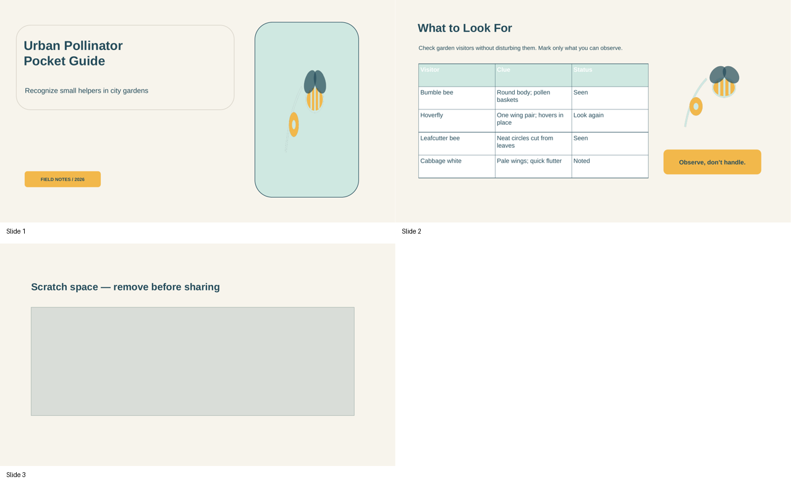
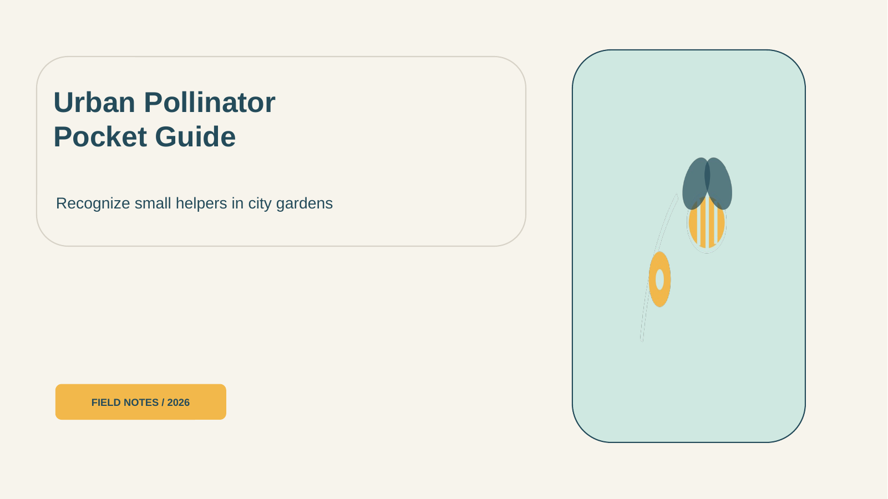
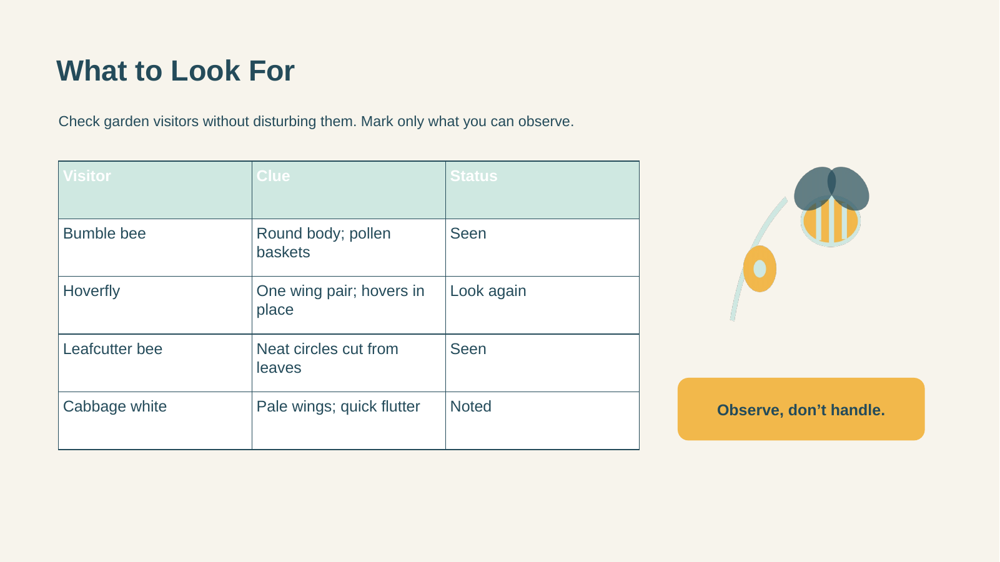
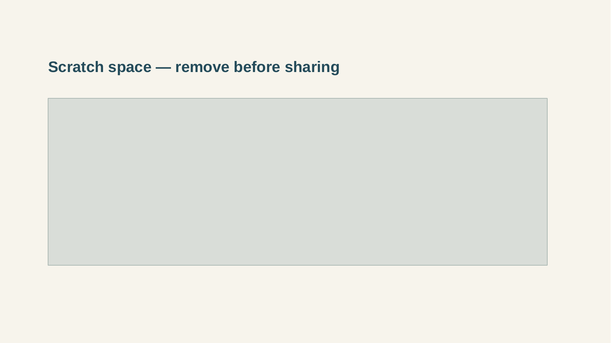

# Urban Pollinator Pocket Guide

- Reference task: `reference-task-impress-full-v2-r01-004`
- Application: `libreoffice_impress`
- Review decision: `pending`

## Task instruction

Finalize the two-slide “Urban Pollinator Pocket Guide” briefing: remove the unused working slide, give the cover slide a navy blue background, and enlarge its bee photograph proportionally until it fills the existing photo window. On the species checklist slide, underline every entry in the table, from the first header cell through the final status cell, so the checklist reads as a marked reference sheet.

## Required skills

### 1. Resize an image proportionally using corner handles

Skill ID: `5d901039-a89c-4bfb-967b-bf66f4df075e.skill-01`

Procedure:

1. Click the image once to select it and show its resize handles.
2. Drag a corner handle outward to enlarge the image while retaining its aspect ratio; for example, drag the top-left handle toward the page’s top-left area.
3. If more enlargement is needed, drag the opposite corner handle outward, such as the bottom-right handle toward the page’s bottom-right area.

Efficiency tip: Use corner handles rather than side handles when enlarging an image proportionally, and make the largest practical resize first to minimize adjustment drags.

Source task: `5d901039-a89c-4bfb-967b-bf66f4df075e`

Source instruction: I want to turn the rectangular image of Columbus on the first page into a cover page. Could you help me stretch this image to fill the entire page, keeping its proportion and centering the image?

Directly referenced source actions:

- Action 0: <code>`CLICK` on the image</code>
- Action 1: <code>`MOVE_TO` top left corner of the image</code>
- Action 2: <code>`DRAG_TO` increase the size of the image</code>
- Action 3: <code>`MOVE_TO` bottom right corner of the image</code>
- Action 4: <code>`DRAG_TO` increase the size of the image</code>

### 2. Delete the currently selected slide with the keyboard

Skill ID: `bf4e9888-f10f-47af-8dba-76413038b73c.skill-02`

Procedure:

1. Select the slide thumbnail to remove in the Slides pane, then press Delete.
2. For example, after generating image slides, select any extra blank starter slide and press Delete to remove it from the presentation.

Efficiency tip: Delete unwanted slides from the thumbnail pane rather than opening each slide and removing its individual contents.

Source task: `bf4e9888-f10f-47af-8dba-76413038b73c`

Source instruction: I have a series of .png images named pic1.png to pic6.png saved on the Desktop. I want to create a new presentation with six blank slides(which means no textbox or any other stuff on the page), and insert one image per slide in order—pic1.png on the first slide, pic2.png on the second, and so on—following the numerical order. The goal is to prepare a presentation suitable for continuous playback in a kiosk or multimedia show. Could you help me with that?

Directly referenced source actions:

- Action 10: <code>`PRESS` delete</code>

### 3. Change a slide background color

Skill ID: `a434992a-89df-4577-925c-0c58b747f0f4.skill-01`

Procedure:

1. Open the slide background color dropdown.
2. Choose a background fill color from the palette; for example, select a red swatch.
3. The selected color is applied to the current slide background.

Efficiency tip: Choose the background color directly from the palette rather than opening additional formatting dialogs when a solid color is all that is needed.

Source task: `a434992a-89df-4577-925c-0c58b747f0f4`

Source instruction: Change the font size of the content to 12, and change the font color to orange. Change the slide's background to red.

Directly referenced source actions:

- Action 0: <code>`CLICK` background dropdown arrow</code>
- Action 1: <code>`CLICK` color</code>
- Action 2: <code>`CLICK` color dropdown arrow</code>
- Action 3: <code>`CLICK` red (2nd row, 5th from left)</code>

### 4. Select a table text range by dragging from the first cell to the last cell

Skill ID: `986fc832-6af2-417c-8845-9272b3a1528b.skill-03`

Procedure:

1. Click the table to activate it, then click at the beginning of the text in its first cell.
2. Drag from that starting caret position through the last cell, ending at the lower-right end of the table content.
3. With the resulting multi-cell text selection active, apply a character format such as underline or font color.

Efficiency tip: Start at the first character and drag continuously to the final cell rather than formatting cells one at a time.

Source task: `986fc832-6af2-417c-8845-9272b3a1528b`

Source instruction: underline the content and make the font color on this slide (including the table) dark red 2.

Directly referenced source actions:

- Action 6: <code>`CLICK` table</code>
- Action 7: <code>`CLICK` cursor before &#x27;Model Name&#x27;</code>
- Action 8: <code>`DRAG_TO` bottom right corner of table</code>

## Initial state preview

### contact-sheet



### slide-01



### slide-02



### slide-03



## Operator guide

### Existing operation-intent guide

#### Demonstration 1

- Skill: `5d901039-a89c-4bfb-967b-bf66f4df075e.skill-01`
- Intent: Scale the centered cover photograph up without distorting it, until it fills the existing tall photo window.
- Efficiency: Select the image and use a corner handle for the largest practical enlargement rather than using side handles.
- Visible success: The bee photo reaches the photo-window boundaries while retaining its original proportions and without visible side or top/bottom gaps.

#### Demonstration 2

- Skill: `bf4e9888-f10f-47af-8dba-76413038b73c.skill-02`
- Intent: Remove the unused internal working slide from the deck.
- Efficiency: Select the third slide’s thumbnail in the Slides pane and press Delete, rather than deleting the slide’s individual objects.
- Visible success: The slide thumbnail list contains only the cover and checklist slides, with no scratch-space slide remaining.

#### Demonstration 3

- Skill: `a434992a-89df-4577-925c-0c58b747f0f4.skill-01`
- Intent: Apply the requested solid navy blue background to the cover slide.
- Efficiency: Use the slide background color palette to choose navy blue directly when a solid fill is required.
- Visible success: The entire slide 1 canvas behind its objects displays a uniform navy blue background.

#### Demonstration 4

- Skill: `986fc832-6af2-417c-8845-9272b3a1528b.skill-03`
- Intent: Apply underline formatting across the complete checklist table text in one continuous selection.
- Efficiency: Activate the table, begin at the first character in the first header cell, and drag continuously through the final character in the lower-right cell before applying underline.
- Visible success: Every table header and every entry through the final Status cell is underlined, with no unformatted cell text left behind.

Recording start: Open the supplied three-slide presentation in normal editing view with all four requested outcomes visibly incomplete.

Recording end: The deck has two slides; the cover has a navy blue background and a proportionally enlarged photo filling its window; and every character in the checklist table is underlined.

Allowed variation: The exact order of the four edits may vary. Minor handle placement variation is acceptable provided the cover image remains proportional, fills the intended photo window, and remains visually aligned with it.

### 中文详细参考方案

> 以下是一个可以参考的操作 guide。标注者可以根据实际 LibreOffice 界面采用等价操作。

本指南完成四项可见编辑：删除第 3 张未使用的工作幻灯片；把封面背景改为标准纯色 navy blue；按比例放大封面的蜜蜂照片至填满既有照片窗口；以及一次连续选中物种清单表格的全部文字并加下划线。操作时要区分：在左侧 `Slides` 窗格单击缩略图是在选择幻灯片；单击对象外框是在选择对象；单击文字内部出现插入光标才是进入文字编辑模式。

#### 启动后的初始状态检查

- 在普通编辑视图确认左侧 `Slides` 窗格共有 3 个缩略图：第 1 张为封面、第 2 张为 checklist、第 3 张为含工作备注的未使用幻灯片。
- 查看第 1 张：画布背景应仍是浅奶油色；蜜蜂照片位于高竖照片窗口中央，照片四周仍可见窗口边框，说明尚未填满。
- 查看第 2 张：`pollinator_observation_table` 的表头和各行文字均为普通文字，尚未出现下划线。
- 先不要改动封面标题、说明文字、照片窗口形状、页脚标签，也不要改动第 2 张的插图、说明文字和 callout。

#### 第 1 步：删除未使用的第 3 张工作幻灯片

1. 在左侧 `Slides` 窗格中，单击第 3 张幻灯片的缩略图，使整个缩略图成为选中状态；这不是单击画布上的 `discarded_working_note` 或 `discarded_placeholder_block` 对象。
2. 按键盘 `Delete`。删除的是当前选中的幻灯片，而不是其中的某一个形状或文字对象。
3. 若缩略图列表已只剩封面和 checklist 两张，则这是可接受的正确状态，无需再次删除；如果第 3 张工作幻灯片仍在，重新单击其缩略图后按 `Delete`。

- 对应 skills：`bf4e9888-f10f-47af-8dba-76413038b73c.skill-02`
- 高效操作：从 `Slides` 缩略图窗格删除整页最快，避免逐个选择并删除工作页内的对象。
- 完成标志：左侧仅剩 2 个缩略图：第 1 张封面和第 2 张 checklist；原工作页及其备注不再出现。

#### 第 2 步：将封面幻灯片背景设为 navy blue

1. 在 `Slides` 窗格单击第 1 张封面缩略图。确认是在选择幻灯片，而不是选择封面上的照片或文字对象。
2. 在右侧 `Properties` 侧边栏的 `Slide` 区域，打开 `Background` 的颜色下拉控件；选择纯色填充，并从调色板直接选取标准的 navy blue 色块。
3. 若画布上对象背后的整块幻灯片画布已经均匀显示 navy blue，则无需调整。若仍显示浅奶油色、只改变了某个形状，或颜色不均匀，先重新在 `Slides` 中选中第 1 张缩略图，再通过 `Properties` > `Slide` > `Background` 的调色板选择 navy blue，而不要给 `cover_text_panel` 或照片窗口单独填色。

- 对应 skills：`a434992a-89df-4577-925c-0c58b747f0f4.skill-01`
- 高效操作：只需要纯色背景时，直接使用 `Background` 调色板的标准 navy blue 色块，不必打开额外的复杂格式对话框。
- 完成标志：第 1 张中所有封面对象背后的画布为统一的 navy blue；标题、文字面板、照片窗口和页脚标签仍存在。

#### 第 3 步：按比例放大封面蜜蜂照片以填满照片窗口

1. 保持第 1 张封面为当前幻灯片。单击蜜蜂照片本身一次，直到照片周围出现选中边框和八个调整大小的手柄；这是按对象外框选择 `cover_bee_photo`，不是进入照片上方文字的编辑模式，也不要选中 `cover_photo_window` 形状。
2. 观察可接受的目标：蜜蜂照片保持原有长宽比例，边缘正好到达既有高竖照片窗口的边界，窗口内没有上、下、左、右的可见空隙。若已经如此，则不需要拖动。
3. 如果照片四周仍有空隙，抓住照片选框的一个角手柄（例如左上角），向照片窗口左上方向向外拖动，作一次尽可能大的放大；不要使用中间的边手柄，因为边手柄会改变比例。
4. 若第一次放大后另一侧仍有空隙，抓住相对的角手柄（例如右下角），向照片窗口右下方向向外拖动，直到照片到达窗口边界。每次拖动后松开鼠标并查看是否仍保持比例。
5. 如果照片已超过窗口、位置偏离窗口，或仍有一侧缺口，继续用相应的角手柄小幅向内或向外修正；目标是照片边缘与窗口边界视觉重合，同时不使用边手柄造成拉伸。

- 对应 skills：`5d901039-a89c-4bfb-967b-bf66f4df075e.skill-01`
- 高效操作：优先以角手柄完成最大的一次放大，再按需用对角微调；角手柄可保留图片比例，通常比多次使用边手柄更高效。
- 完成标志：蜜蜂照片填满原有高竖照片窗口，无可见边框空隙；图片中的蜜蜂和薰衣草没有被横向或纵向拉伸。

#### 第 4 步：连续选中 checklist 表格从首个表头到最终 Status 单元格的全部文字

1. 在 `Slides` 窗格单击第 2 张 checklist 缩略图。不要在第 1 张封面上继续操作。
2. 单击 `pollinator_observation_table` 内部以激活表格，然后在左上第一个表头单元格的第一个字符之前再单击，使插入光标位于表格文字开头。这一步是进入表格的文字编辑模式，不是只选中表格的外框。
3. 从该首字符前的位置按住鼠标左键，连续拖动选择范围，穿过所有表头和正文单元格，直至右下角最终 `Status` 单元格中文字的最后一个字符之后再松开。应出现跨越整个表格文字的高亮选区。
4. 若已能看到从第一个表头到最后一个 `Status` 内容的连续文字选区，这是可接受的正确状态，无需重新选。若只高亮了一个单元格、仅选中了表格边框、遗漏中间行，或终点没有到达最终 `Status` 单元格，请单击表内首字符前取消错误范围，然后从首字符重新一次连续拖至右下最后字符。

- 对应 skills：`986fc832-6af2-417c-8845-9272b3a1528b.skill-03`
- 高效操作：一次从第一个字符连续拖到最终单元格，可同时覆盖表头与所有条目，避免逐格重复格式化。
- 完成标志：表格文本选区从左上第一个表头开始，连续覆盖每一个表头、每行条目，直到右下最终 `Status` 单元格的末尾。

#### 第 5 步：给已选中的整张 checklist 表格文字添加下划线

1. 在步骤 4 的多单元格文字选区仍保持高亮时，按 `Ctrl+U` 应用下划线。不要先单击画布空白处，否则会丢失文字选区。
2. 若表头及所有表格条目已经都显示下划线，且包括右下最终 `Status` 单元格，则无需再操作。若有未加下划线的文字，说明先前选区未覆盖完整范围；重新按步骤 4 从首字符连续选择到最终字符，再按 `Ctrl+U`。
3. 单击表格外的空白画布以取消选择，便于检查最终视觉效果；不要改动表格边框、单元格填充或第 2 张的其他对象。

- 对应 skills：无；这是准备或检查步骤。
- 高效操作：在连续文字选区仍存在时立即使用 `Ctrl+U`，可将字符格式一次应用到全表。
- 完成标志：第 2 张表格的每个表头和每项内容均有清晰下划线，最末 `Status` 单元格也没有遗漏。

#### 最终结果检查

- 检查左侧 `Slides` 窗格：仅有两张幻灯片，顺序仍为封面第 1 张、checklist 第 2 张，没有工作幻灯片。
- 检查第 1 张缩略图及画布：背景是均匀 navy blue；蜜蜂照片按原比例填满既有照片窗口且视觉对齐，没有任何边缘空隙或变形。
- 检查第 1 张的无关内容：封面标题、副标题、文字面板和页脚标签仍存在且未被删除或意外改写。
- 检查第 2 张缩略图及画布：表格从第一个表头到最后 `Status` 单元格的所有文字均有下划线。
- 检查第 2 张的无关内容：`checklist_heading`、`checklist_intro`、侧边插图和 callout 保持原有位置与内容，未被意外格式化或删除。

## Source-task similarity review

| Measure | Maximum | Most similar source task |
| --- | ---: | --- |
| Lexical sequence similarity | 0.258706 | 5d901039-a89c-4bfb-967b-bf66f4df075e |
| Semantic cosine similarity | 0.528282 | 8979838c-54a5-4454-a2b8-3d135a1a5c8f |

Similarity scores are reviewer aids, not automatic acceptance thresholds. Inspect the contributing source tasks and their complete ordered actions below.

### Source task `5d901039-a89c-4bfb-967b-bf66f4df075e`

Original instruction:

> I want to turn the rectangular image of Columbus on the first page into a cover page. Could you help me stretch this image to fill the entire page, keeping its proportion and centering the image?

Required skills derived from this source task:

- **Resize an image proportionally using corner handles** — `5d901039-a89c-4bfb-967b-bf66f4df075e.skill-01`

Complete ordered single-action sequence:

| Action | Related required skill | Original single action |
| ---: | --- | --- |
| 0 | <strong>★ Resize an image proportionally using corner handles</strong><br><code>5d901039-a89c-4bfb-967b-bf66f4df075e.skill-01</code> | <strong><code>`CLICK` on the image</code></strong> |
| 1 | <strong>★ Resize an image proportionally using corner handles</strong><br><code>5d901039-a89c-4bfb-967b-bf66f4df075e.skill-01</code> | <strong><code>`MOVE_TO` top left corner of the image</code></strong> |
| 2 | <strong>★ Resize an image proportionally using corner handles</strong><br><code>5d901039-a89c-4bfb-967b-bf66f4df075e.skill-01</code> | <strong><code>`DRAG_TO` increase the size of the image</code></strong> |
| 3 | <strong>★ Resize an image proportionally using corner handles</strong><br><code>5d901039-a89c-4bfb-967b-bf66f4df075e.skill-01</code> | <strong><code>`MOVE_TO` bottom right corner of the image</code></strong> |
| 4 | <strong>★ Resize an image proportionally using corner handles</strong><br><code>5d901039-a89c-4bfb-967b-bf66f4df075e.skill-01</code> | <strong><code>`DRAG_TO` increase the size of the image</code></strong> |
| 5 |  | <code>`MOVE_TO` center of the image</code> |
| 6 |  | <code>`DRAG_TO` move the image into the center of the page</code> |

### Source task `986fc832-6af2-417c-8845-9272b3a1528b`

Original instruction:

> underline the content and make the font color on this slide (including the table) dark red 2.

Required skills derived from this source task:

- **Select a table text range by dragging from the first cell to the last cell** — `986fc832-6af2-417c-8845-9272b3a1528b.skill-03`

Complete ordered single-action sequence:

| Action | Related required skill | Original single action |
| ---: | --- | --- |
| 0 |  | <code>`CLICK` outline</code> |
| 1 |  | <code>`HOTKEY` ctrl-A</code> |
| 2 |  | <code>`HOTKEY` ctrl-U</code> |
| 3 |  | <code>`CLICK` font color icon</code> |
| 4 |  | <code>`CLICK` dark red 2</code> |
| 5 |  | <code>`CLICK` normal</code> |
| 6 | <strong>★ Select a table text range by dragging from the first cell to the last cell</strong><br><code>986fc832-6af2-417c-8845-9272b3a1528b.skill-03</code> | <strong><code>`CLICK` table</code></strong> |
| 7 | <strong>★ Select a table text range by dragging from the first cell to the last cell</strong><br><code>986fc832-6af2-417c-8845-9272b3a1528b.skill-03</code> | <strong><code>`CLICK` cursor before &#x27;Model Name&#x27;</code></strong> |
| 8 | <strong>★ Select a table text range by dragging from the first cell to the last cell</strong><br><code>986fc832-6af2-417c-8845-9272b3a1528b.skill-03</code> | <strong><code>`DRAG_TO` bottom right corner of table</code></strong> |
| 9 |  | <code>`HOTKEY` ctrl-U</code> |
| 10 |  | <code>`CLICK` font color icon</code> |

### Source task `a434992a-89df-4577-925c-0c58b747f0f4`

Original instruction:

> Change the font size of the content to 12, and change the font color to orange. Change the slide's background to red.

Required skills derived from this source task:

- **Change a slide background color** — `a434992a-89df-4577-925c-0c58b747f0f4.skill-01`

Complete ordered single-action sequence:

| Action | Related required skill | Original single action |
| ---: | --- | --- |
| 0 | <strong>★ Change a slide background color</strong><br><code>a434992a-89df-4577-925c-0c58b747f0f4.skill-01</code> | <strong><code>`CLICK` background dropdown arrow</code></strong> |
| 1 | <strong>★ Change a slide background color</strong><br><code>a434992a-89df-4577-925c-0c58b747f0f4.skill-01</code> | <strong><code>`CLICK` color</code></strong> |
| 2 | <strong>★ Change a slide background color</strong><br><code>a434992a-89df-4577-925c-0c58b747f0f4.skill-01</code> | <strong><code>`CLICK` color dropdown arrow</code></strong> |
| 3 | <strong>★ Change a slide background color</strong><br><code>a434992a-89df-4577-925c-0c58b747f0f4.skill-01</code> | <strong><code>`CLICK` red (2nd row, 5th from left)</code></strong> |
| 4 |  | <code>`CLICK` the content text box</code> |
| 5 |  | <code>`TRIPLE_CLICK` the font size text field</code> |
| 6 |  | <code>`TYPING` 12</code> |
| 7 |  | <code>`PRESS` enter</code> |
| 8 |  | <code>`CLICK` the font color dropdown arrow</code> |
| 9 |  | <code>`CLICK` the orange color (2nd row, 3rd from left)</code> |

### Source task `bf4e9888-f10f-47af-8dba-76413038b73c`

Original instruction:

> I have a series of .png images named pic1.png to pic6.png saved on the Desktop. I want to create a new presentation with six blank slides(which means no textbox or any other stuff on the page), and insert one image per slide in order—pic1.png on the first slide, pic2.png on the second, and so on—following the numerical order. The goal is to prepare a presentation suitable for continuous playback in a kiosk or multimedia show. Could you help me with that?

Required skills derived from this source task:

- **Delete the currently selected slide with the keyboard** — `bf4e9888-f10f-47af-8dba-76413038b73c.skill-02`

Complete ordered single-action sequence:

| Action | Related required skill | Original single action |
| ---: | --- | --- |
| 0 |  | <code>`CLICK` Insert in the menu bar.</code> |
| 1 |  | <code>`CLICK` Media.</code> |
| 2 |  | <code>`CLICK` Photo Album...</code> |
| 3 |  | <code>`CLICK` Add.</code> |
| 4 |  | <code>`CLICK` Desktop</code> |
| 5 |  | <code>`KEY_DOWN` &#x27;Shift&#x27;.</code> |
| 6 |  | <code>`CLICK` pic6.png.</code> |
| 7 |  | <code>`KEY_UP` Shift.</code> |
| 8 |  | <code>`PRESS` enter.</code> |
| 9 |  | <code>`CLICK` Insert Slides.</code> |
| 10 | <strong>★ Delete the currently selected slide with the keyboard</strong><br><code>bf4e9888-f10f-47af-8dba-76413038b73c.skill-02</code> | <strong><code>`PRESS` delete</code></strong> |

## Review this package

Before choosing a decision, complete all three checks:

- [ ] **Task naturalness and skill necessity:** Is the reference task a natural Impress task, and is every listed required skill genuinely necessary and observable when solving it?
- [ ] **Initial artifact correctness:** Launch the environment and confirm that the presentation opens correctly, contains the content needed by the instruction, and has not already completed the requested results.
- [ ] **Source-task similarity:** Compare the reference task with the source instructions and complete single-action sequences above. Confirm that it is not merely an entity, field, or value substitution and does not reproduce a source task's complete ordered solution.

Use `approved` when all checks pass. Use `revision_requested` when the package is fixable and provide concrete revision instructions. Use `rejected` when the combination is fundamentally unnatural, infeasible, or too similar to a source task.

Fill [review.json](review.json), then collect completed forms from the repository root:

```bash
python scripts/python/manage_reference_review_packets.py collect \
  --skill-pool evaluation_examples/expert_skill_learning/impress_full_v1/generated_v2/skill_pool.json \
  --packages evaluation_examples/expert_skill_learning/impress_full_v1/generated_v2/round_01/reference_packages.json \
  --source-tasks evaluation_examples/expert_skill_learning/impress_full_v1/source_tasks.json \
  --reviews evaluation_examples/expert_skill_learning/impress_full_v1/generated_v2/round_01/reference_package_reviews.json \
  --artifact-manifest evaluation_examples/expert_skill_learning/impress_full_v1/generated_v2/round_01/artifacts/artifact_manifest.json \
  --task-config-manifest evaluation_examples/expert_skill_learning/impress_full_v1/generated_v2/round_01/task_config_manifest.json \
  --task-detail-root evaluation_examples/expert_skill_learning/impress_full_v1/generated_v2/round_01/task_details \
  --reviewer-guides evaluation_examples/expert_skill_learning/impress_full_v1/generated_v2/round_01/reviewer_guides.json \
  --coverage evaluation_examples/expert_skill_learning/impress_full_v1/generated_v2/round_01/coverage_state.json \
  --packet-root evaluation_examples/expert_skill_learning/impress_full_v1/generated_v2/round_01/review_packets
```

Detailed field guidance is in [`reviewer.md`](../../../../../reviewer.md).
