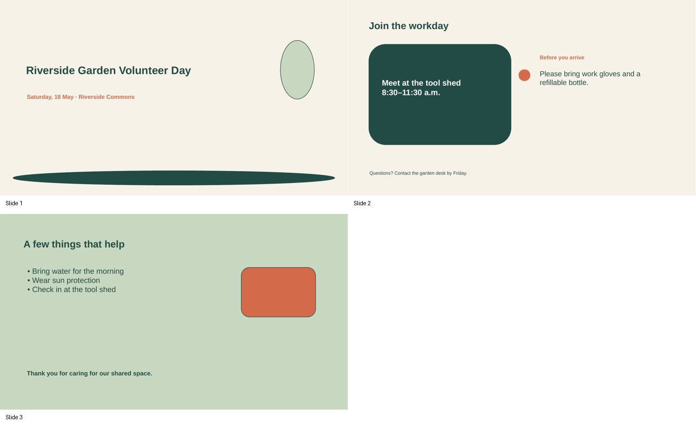
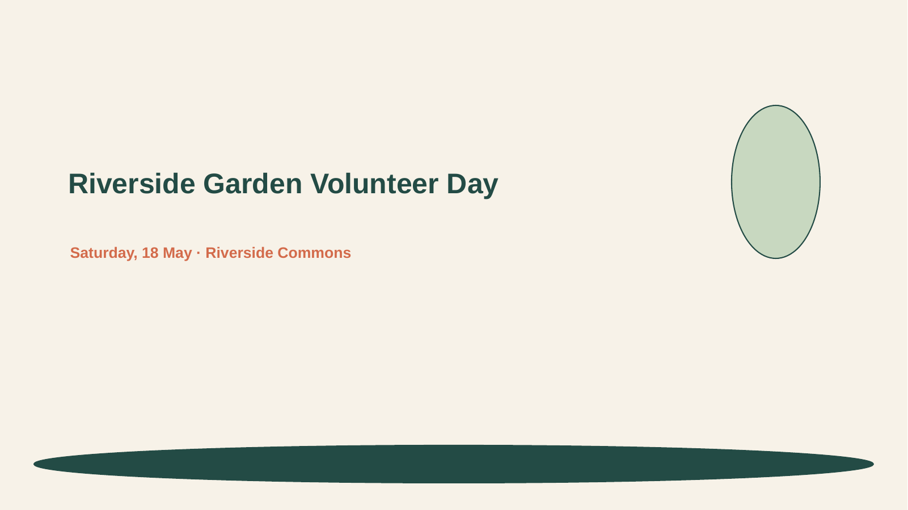
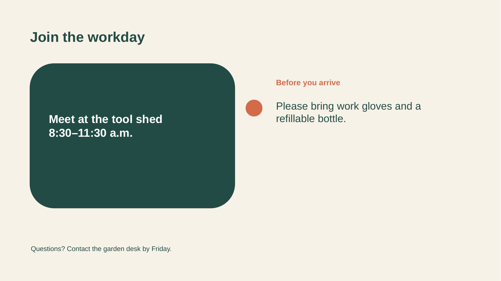
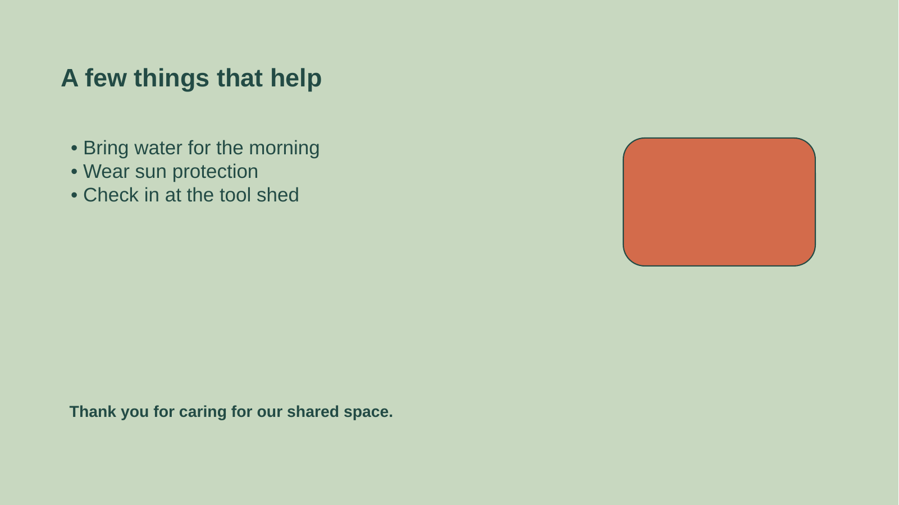

# Riverside Garden Volunteer Day

- Reference task: `reference-task-impress-full-v2-r01-005`
- Application: `libreoffice_impress`
- Review decision: `pending`

## Task instruction

On the “Join the workday” slide, establish the two color cues for the event: make all text inside the dark-green schedule card use the standard Yellow font-color palette swatch, and recolor only the words “bring work gloves” in the preparation sentence with the Dark Red 2 palette swatch. Leave the rest of the preparation sentence unchanged.

## Required skills

### 1. Apply a font color from the font-color palette

Skill ID: `986fc832-6af2-417c-8845-9272b3a1528b.skill-02`

Procedure:

1. Select the text whose character color should change.
2. Click the Font Color button to open its color palette.
3. Choose the desired palette swatch; for example, select the “Dark Red 2” swatch to apply that color to the selected text.

Efficiency tip: Select the complete text range before opening the palette so a single color choice formats the entire range at once.

Source task: `986fc832-6af2-417c-8845-9272b3a1528b`

Source instruction: underline the content and make the font color on this slide (including the table) dark red 2.

Directly referenced source actions:

- Action 3: <code>`CLICK` font color icon</code>
- Action 4: <code>`CLICK` dark red 2</code>

### 2. Set the font color of all text in a text box using the color palette

Skill ID: `57667013-ea97-417c-9dce-2713091e6e2a.skill-01`

Procedure:

1. Click inside the target text box to enter text-editing mode.
2. Press Ctrl+A to select all text in that text box.
3. Open the Font Color drop-down and choose the required palette color. For example, choose the standard yellow swatch rather than a light or dark variation.

Efficiency tip: Use Ctrl+A only after entering the intended text box; this selects its text without selecting other objects on the slide, allowing the color to be applied in one operation.

Source task: `57667013-ea97-417c-9dce-2713091e6e2a`

Source instruction: Navigate to slide 5 and set the font color of all textboxes to yellow. Use exactly 'yellow'—no variations such as light yellow, dark yellow, or any other color.

Directly referenced source actions:

- Action 1: <code>`CLICK` text in &#x27;write an original...&#x27;</code>
- Action 2: <code>`HOTKEY` ctrl-A</code>
- Action 3: <code>`CLICK` font color dropdown.</code>
- Action 4: <code>`CLICK` yellow (2nd row, first from left)</code>

## Initial state preview

### contact-sheet



### slide-01



### slide-02



### slide-03



## Operator guide

### Existing operation-intent guide

#### Demonstration 1

- Skill: `986fc832-6af2-417c-8845-9272b3a1528b.skill-02`
- Intent: Apply Dark Red 2 only to the phrase “bring work gloves” within the preparation sentence on slide 2.
- Efficiency: Enter text-editing mode in the preparation sentence and select exactly the target phrase before opening the Font Color palette.
- Visible success: Only those three words appear in Dark Red 2, while “Please” and “and a refillable bottle.” remain dark green.

#### Demonstration 2

- Skill: `57667013-ea97-417c-9dce-2713091e6e2a.skill-01`
- Intent: Apply the standard Yellow palette swatch to every character in the schedule callout on slide 2.
- Efficiency: Click inside the schedule text box first, then use Ctrl+A to select only that text box’s complete text before choosing Yellow from the Font Color palette.
- Visible success: Both lines, “Meet at the tool shed” and “8:30–11:30 a.m.”, display in the same standard Yellow against the dark-green card.

Recording start: Open the supplied presentation in LibreOffice Impress with slide 2 selected or readily accessible; all requested text is still in its initial colors.

Recording end: Slide 2 retains its original layout and wording, the whole schedule callout is standard Yellow, and only “bring work gloves” is Dark Red 2.

Allowed variation: Equivalent efficient selection and palette-opening paths are acceptable if the specified palette colors and exact text scope are preserved.

### 中文详细参考方案

> 以下是一个可以参考的操作 guide。标注者可以根据实际 LibreOffice 界面采用等价操作。

本指南在第 2 张“Join the workday”幻灯片上建立两处文字颜色提示：将深绿色日程卡中的全部日程文字改为标准 `Yellow`，并且仅将准备提示句中的“bring work gloves”改为 `Dark Red 2`。除这两处字符颜色外，不修改文字内容、字体、字号、对齐、形状或幻灯片布局。

#### 启动后的初始状态检查

- 在 LibreOffice Impress 中打开演示文稿，确认左侧缩略图窗格中共有 3 张宽屏幻灯片，且第 2 张为包含深绿色日程卡和准备提示句的“Join the workday”页面。
- 单击第 2 张幻灯片缩略图以选择幻灯片；这只是选择页面，不等同于选中页面上的文本框对象，也尚未进入文字编辑模式。
- 确认深绿色卡片中的两行日程文字当前为白色，且准备提示句中的“bring work gloves”目前与其余句子同为深绿色。若初始状态已经有任一目标颜色，请不要再次套用不同颜色；只处理仍不符合要求的目标文字范围。
- 确认第 1 张和第 3 张缩略图内容完整；本任务不需要在这两张幻灯片上选择或编辑任何对象。

#### 第 1 步：定位第 2 张中的两个独立文字对象

1. 单击左侧第 2 张缩略图，进入含深绿色日程卡的幻灯片。随后在画布空白处单击一次，避免保留其他对象的选择边框。
2. 辨认两个目标：深绿色卡片内的日程文字对象，以及浅色背景上的准备提示句文字对象。它们是不同的文本框；不要通过单击对象边框来同时选择它们，也不要使用 `Shift` 多选，因为两处颜色和文字范围不同。
3. 日程卡中应包含“Meet at the tool shed”和“8:30–11:30 a.m.”两行。准备提示句中仅有连续短语“bring work gloves”需要单独变色。

- 对应 skills：无；这是准备或检查步骤。
- 高效操作：先确认对象边界和文字位置，再进入文字编辑模式，可避免把卡片形状或整个准备句文本框误当成目标。
- 完成标志：第 2 张幻灯片处于当前编辑视图，且尚未出现意外移动、缩放或变形的对象。

#### 第 2 步：将日程卡内全部文字设为标准 Yellow

1. 在深绿色日程卡的日程文字上单击，使插入光标出现在文字中。此时是进入该文本框的文字编辑模式，不是只选中文本框对象的边框。
2. 在确认光标位于日程文字文本框内后，按 `Ctrl+A`。检查两行日程文字都出现文字选中高亮；若出现的是对象边框或整张幻灯片被影响，先按 `Esc`，再在日程文字字符中单击后重新按 `Ctrl+A`。
3. 在工具栏打开 `Font Color` 的下拉调色板，并选择标准色板项 `Yellow`。选择名称准确为 `Yellow` 的标准黄色，不要选择浅黄、深黄或其他黄色变体。
4. 若两行已经均为相同的标准 `Yellow`，可不作调整。若只有一行变黄，说明选择范围不完整：重新在该日程文本框中进入文字编辑模式，按 `Ctrl+A` 选中该文本框全部文字后再选择 `Yellow`。

- 对应 skills：`57667013-ea97-417c-9dce-2713091e6e2a.skill-01`
- 高效操作：必须先进入目标文本框的文字编辑模式再按 `Ctrl+A`；这样一次即可覆盖这个文本框的全部字符，而不会选到页面上其他对象。
- 完成标志：深绿色卡片上的“Meet at the tool shed”和“8:30–11:30 a.m.”两行均显示为相同的标准 `Yellow`，卡片填充仍为深绿色。

#### 第 3 步：只将 bring work gloves 设为 Dark Red 2

1. 按 `Esc` 退出日程文字的选择状态，然后在准备提示句的字符上单击，进入准备提示句文本框的文字编辑模式。不要只单击文本框边框；边框选择只能选对象，不能精确设置短语中的字符颜色。
2. 通过拖选从“bring”的 b 到“gloves”的 s，或将插入光标置于短语一端后按住 `Shift` 并用方向键扩展选择，精确选中“bring work gloves”。不要包含其前的“Please”或其后的“and a refillable bottle.”，也不要选中额外空格。
3. 保持该短语处于文字选中状态，打开 `Font Color` 调色板，选择 `Dark Red 2`。
4. 若仅“bring work gloves”已经是 `Dark Red 2`，且“Please”和“and a refillable bottle.”仍为深绿色，则无需调整。若整个准备提示句都变成 `Dark Red 2`，在该文本框中重新精确选中不应变红的文字并从 `Font Color` 调色板恢复其原有深绿色；更稳妥的做法是撤销该次整句着色后，重新仅选择目标短语并应用 `Dark Red 2`。

- 对应 skills：`986fc832-6af2-417c-8845-9272b3a1528b.skill-02`
- 高效操作：在打开 `Font Color` 前先完成短语的精确选择；调色板只会格式化当前高亮的字符范围。
- 完成标志：准备提示句中只有“bring work gloves”为 `Dark Red 2`；“Please”和“and a refillable bottle.”保持原有深绿色，句子文字、空格和换行均未改变。

#### 第 4 步：退出编辑状态并检查页面未发生其他改动

1. 在幻灯片空白处单击，退出文字编辑模式，以便在非高亮状态下检查实际颜色对比。
2. 查看日程卡：可接受的结果是两行日程文字均为标准 `Yellow`。如果仍有白色字符或黄色深浅不一致，重新进入日程文字文本框，使用 `Ctrl+A` 选中全部文本，并从 `Font Color` 中选择 `Yellow`。
3. 查看准备提示句：可接受的结果是只有“bring work gloves”为 `Dark Red 2`。如果相邻词语也变红，进入该句文本框并修正选区或撤销错误的整句格式化后重做。
4. 不要拖动任何对象边框，也不要更改深绿色卡片、背景、标题或页脚。

- 对应 skills：无；这是准备或检查步骤。
- 高效操作：在空白处单击后再检查，能避免选中高亮遮挡真实的字体颜色。
- 完成标志：第 2 张保持原有双栏布局、文字位置和措辞；仅两项指定的字体颜色发生变化。

#### 最终结果检查

- 检查第 2 张缩略图及画布：深绿色日程卡中的全部文字，即“Meet at the tool shed”和“8:30–11:30 a.m.”，都为标准 `Yellow`。
- 检查准备提示句：仅“bring work gloves”为 `Dark Red 2`；“Please”和“and a refillable bottle.”保持深绿色，且整句仍是同一可编辑段落。
- 确认没有将 `Dark Red 2` 套用到整个准备提示句，也没有使用任何非标准的黄色变体。
- 检查第 1 张和第 3 张缩略图，确认其文字、形状、背景和布局均保持不变；第 2 张中除指定文字颜色外，其余内容也未改变。

## Source-task similarity review

| Measure | Maximum | Most similar source task |
| --- | ---: | --- |
| Lexical sequence similarity | 0.338645 | 57667013-ea97-417c-9dce-2713091e6e2a |
| Semantic cosine similarity | 0.637427 | 04578141-1d42-4146-b9cf-6fab4ce5fd74 |

Similarity scores are reviewer aids, not automatic acceptance thresholds. Inspect the contributing source tasks and their complete ordered actions below.

### Source task `57667013-ea97-417c-9dce-2713091e6e2a`

Original instruction:

> Navigate to slide 5 and set the font color of all textboxes to yellow. Use exactly 'yellow'—no variations such as light yellow, dark yellow, or any other color.

Required skills derived from this source task:

- **Set the font color of all text in a text box using the color palette** — `57667013-ea97-417c-9dce-2713091e6e2a.skill-01`

Complete ordered single-action sequence:

| Action | Related required skill | Original single action |
| ---: | --- | --- |
| 0 |  | <code>`CLICK` slide 5</code> |
| 1 | <strong>★ Set the font color of all text in a text box using the color palette</strong><br><code>57667013-ea97-417c-9dce-2713091e6e2a.skill-01</code> | <strong><code>`CLICK` text in &#x27;write an original...&#x27;</code></strong> |
| 2 | <strong>★ Set the font color of all text in a text box using the color palette</strong><br><code>57667013-ea97-417c-9dce-2713091e6e2a.skill-01</code> | <strong><code>`HOTKEY` ctrl-A</code></strong> |
| 3 | <strong>★ Set the font color of all text in a text box using the color palette</strong><br><code>57667013-ea97-417c-9dce-2713091e6e2a.skill-01</code> | <strong><code>`CLICK` font color dropdown.</code></strong> |
| 4 | <strong>★ Set the font color of all text in a text box using the color palette</strong><br><code>57667013-ea97-417c-9dce-2713091e6e2a.skill-01</code> | <strong><code>`CLICK` yellow (2nd row, first from left)</code></strong> |
| 5 |  | <code>`TRIPLE_CLICK` text in &#x27;Include a credit&#x27;...</code> |
| 6 |  | <code>`CLICK` font color.</code> |

### Source task `986fc832-6af2-417c-8845-9272b3a1528b`

Original instruction:

> underline the content and make the font color on this slide (including the table) dark red 2.

Required skills derived from this source task:

- **Apply a font color from the font-color palette** — `986fc832-6af2-417c-8845-9272b3a1528b.skill-02`

Complete ordered single-action sequence:

| Action | Related required skill | Original single action |
| ---: | --- | --- |
| 0 |  | <code>`CLICK` outline</code> |
| 1 |  | <code>`HOTKEY` ctrl-A</code> |
| 2 |  | <code>`HOTKEY` ctrl-U</code> |
| 3 | <strong>★ Apply a font color from the font-color palette</strong><br><code>986fc832-6af2-417c-8845-9272b3a1528b.skill-02</code> | <strong><code>`CLICK` font color icon</code></strong> |
| 4 | <strong>★ Apply a font color from the font-color palette</strong><br><code>986fc832-6af2-417c-8845-9272b3a1528b.skill-02</code> | <strong><code>`CLICK` dark red 2</code></strong> |
| 5 |  | <code>`CLICK` normal</code> |
| 6 |  | <code>`CLICK` table</code> |
| 7 |  | <code>`CLICK` cursor before &#x27;Model Name&#x27;</code> |
| 8 |  | <code>`DRAG_TO` bottom right corner of table</code> |
| 9 |  | <code>`HOTKEY` ctrl-U</code> |
| 10 |  | <code>`CLICK` font color icon</code> |

## Review this package

Before choosing a decision, complete all three checks:

- [ ] **Task naturalness and skill necessity:** Is the reference task a natural Impress task, and is every listed required skill genuinely necessary and observable when solving it?
- [ ] **Initial artifact correctness:** Launch the environment and confirm that the presentation opens correctly, contains the content needed by the instruction, and has not already completed the requested results.
- [ ] **Source-task similarity:** Compare the reference task with the source instructions and complete single-action sequences above. Confirm that it is not merely an entity, field, or value substitution and does not reproduce a source task's complete ordered solution.

Use `approved` when all checks pass. Use `revision_requested` when the package is fixable and provide concrete revision instructions. Use `rejected` when the combination is fundamentally unnatural, infeasible, or too similar to a source task.

Fill [review.json](review.json), then collect completed forms from the repository root:

```bash
python scripts/python/manage_reference_review_packets.py collect \
  --skill-pool evaluation_examples/expert_skill_learning/impress_full_v1/generated_v2/skill_pool.json \
  --packages evaluation_examples/expert_skill_learning/impress_full_v1/generated_v2/round_01/reference_packages.json \
  --source-tasks evaluation_examples/expert_skill_learning/impress_full_v1/source_tasks.json \
  --reviews evaluation_examples/expert_skill_learning/impress_full_v1/generated_v2/round_01/reference_package_reviews.json \
  --artifact-manifest evaluation_examples/expert_skill_learning/impress_full_v1/generated_v2/round_01/artifacts/artifact_manifest.json \
  --task-config-manifest evaluation_examples/expert_skill_learning/impress_full_v1/generated_v2/round_01/task_config_manifest.json \
  --task-detail-root evaluation_examples/expert_skill_learning/impress_full_v1/generated_v2/round_01/task_details \
  --reviewer-guides evaluation_examples/expert_skill_learning/impress_full_v1/generated_v2/round_01/reviewer_guides.json \
  --coverage evaluation_examples/expert_skill_learning/impress_full_v1/generated_v2/round_01/coverage_state.json \
  --packet-root evaluation_examples/expert_skill_learning/impress_full_v1/generated_v2/round_01/review_packets
```

Detailed field guidance is in [`reviewer.md`](../../../../../reviewer.md).
